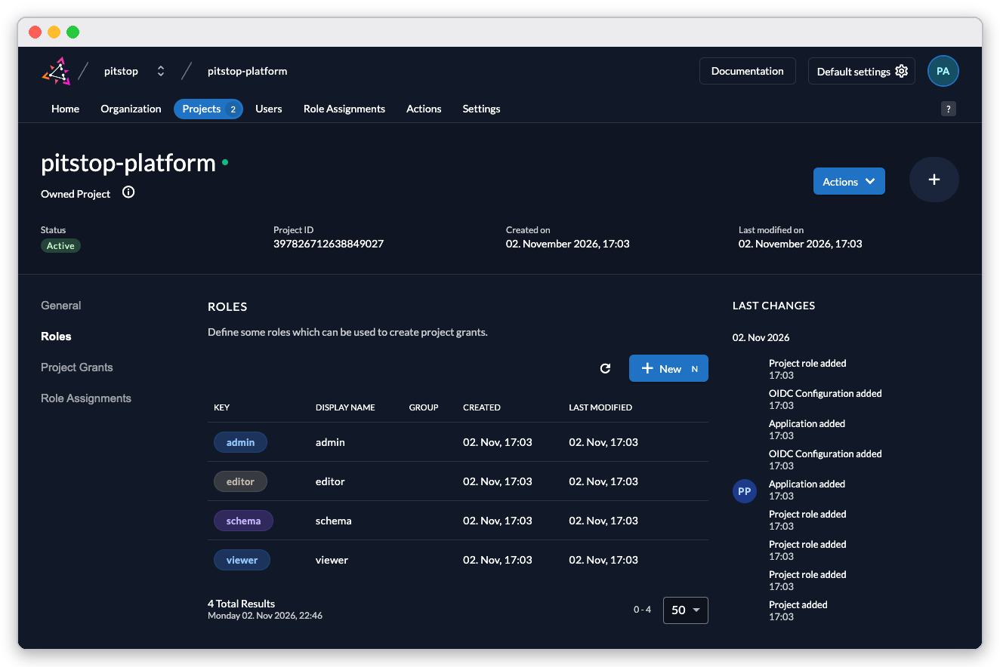
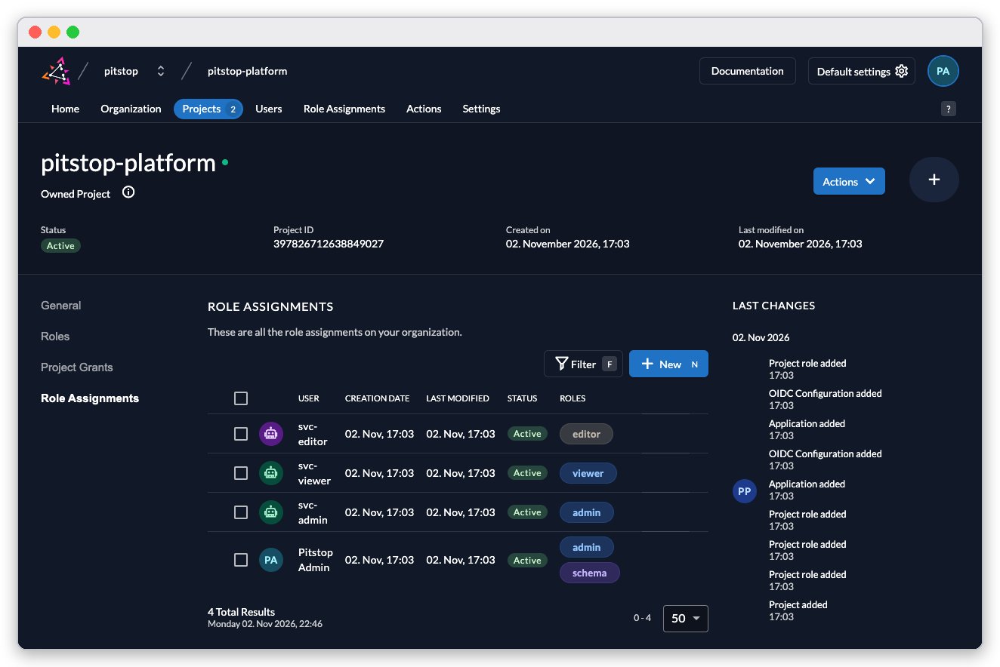
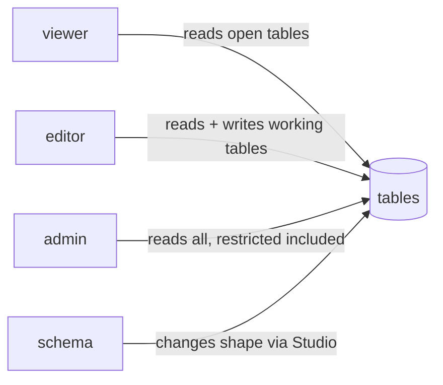

# Reference: identity, roles and who sees what

Every call to Minimal is made as one identity, and Core enforces that identity's roles on every table. This guide names the roles an install ships with, who holds them, and what each may do — worked on the CRM dataset.

## The four roles

The project `pitstop-platform` in the identity console defines four roles:



*The four project roles: `admin`, `editor`, `schema` and `viewer`.*

- `viewer` reads the open tables and is refused the rest.
- `editor` reads more (the staff tables among them) and may create and change rows where the dataset allows writes.
- `admin` reads everything, including the restricted tables.
- `schema` is not a data role: it is the right to change database shape through Minimal Studio, and only the first admin holds it ([Connect Minimal Studio](howto-minimal-studio.md)).

## Who holds what after an install



*The shipped grants: three demo service users with one role each, and the human admin with `admin` and `schema`.*

- **Pitstop Admin** — the first human user (`admin@pitstop.auth.<name>`): `admin` and `schema`.
- **svc-editor**, **svc-viewer**, **svc-admin** — demo service accounts with `editor`, `viewer` and `admin`. Their credentials are in the API environment file the installer offers ([The REST API](reference-rest-api.md)); they exist so you can try each role without creating users.

Service accounts live under **Users → Service Accounts** in the console; humans under **Users**.

Anyone who can reach the sign-in page can register an account — and a registered account has **no roles** and sees no data. "Core refused this read for your roles" is the permission system working. To grant a role: console → **Projects** → **pitstop-platform** → **Role Assignments** → **New**.

## What each role gets: access classes

Every table in a dataset carries an access class — open, working, staff, ledger or restricted — and the class decides who reads and who writes. The installer's **Start with.** screen describes your dataset's split under **Who sees what**.

On the CRM dataset:

- The `quota` table is staff-class: an editor reads it (HTTP 200), a viewer is refused:

  ```text
  HTTP 403
  insufficient permissions for this operation on this table, got [viewer]
  ```

- The `opportunity` table is working-class: an editor's insert succeeds (`{"rows_affected": 1}`), a viewer's insert is refused with the same 403.
- Deleting over the API is refused even for roles that write — a delete on `opportunity` as the editor answers:

  ```text
  HTTP 403
  insufficient permissions for this operation on this table, got [editor]
  ```

Read-only is the shipped posture everywhere else: a write to a table whose class does not allow it is a 403, whoever asks. Widening that — like opening a table's rows to MCP — is an explicit, reversible act by an admin, shown step by step in [Minimal over MCP](../guides/mcp-developer-guide.md#4-read-and-change-rows-with-the-auto-api).



*Roles widen from viewer to admin; `schema` changes the shape, not the rows.*

## The MCP channel is its own gate

An MCP session's roles come from its token, and on top of the role check every table starts **locked** for MCP row operations — even an admin token is refused until the table's lock mask and permission template both allow the call. Deployed Custom APIs are the intended path for agents; [Minimal over MCP](../guides/mcp-developer-guide.md) shows both the refusal and the deliberate unlock.
