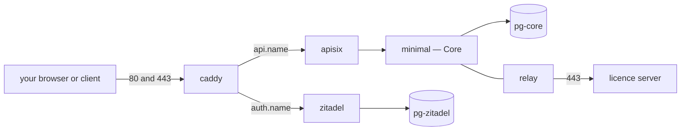

# Reference: the stack

One compose file runs everything. After an install, `docker compose ps` in your install folder lists eleven long-running services; the installer (`wizard`) is a twelfth until you press **Finish — close the installer**.

| Service | What it is |
|---|---|
| `caddy` | the front door: the only service with published ports (80 and 443), and the holder of the certificates |
| `apisix` | the API gateway behind the front door |
| `minimal` | Minimal Core: the REST API, Custom APIs, permissions and the MCP door |
| `zitadel`, `zitadel-login` | the identity service: sign-in pages and the management console |
| `app` | the sample workspace app, served at `/app/` |
| `relay` | the licence relay — the only service that talks to the licence server, at `relay.license.littlebitlabs.com:443` |
| `resolver` | internal plumbing; healthy means fine |
| `pg-core` | Postgres for Core's own data: definitions, apps, sessions, the audit trail |
| `pg-app` | Postgres for the sample dataset you chose |
| `pg-zitadel` | Postgres for the identity service |

Services with a health check report `(healthy)`; `app` and `zitadel` have none by design. Everything else reporting `running (healthy)` — `caddy`, `minimal`, `resolver` and `relay` in particular — is the quick health read; [the tour](howto-operate.md) is the real one.



*The two names, the front door, the gateway, Core, and the one licence connection.*

## The helpers

The same compose file defines one-shot services you run on demand with `docker compose run --rm -T <name>`:

| Helper | What it does |
|---|---|
| `tour` | proves the install: an editor read, a viewer refusal, the MCP door |
| `admin-password` | prints the admin's initial password (shown nowhere else) |
| `backup`, `restore-state`, `restore-data` | a full backup to stdout, and the two-step restore |
| `ca-cert` | LAN mode: prints the stack's root certificate and its fingerprint |
| `qr` | LAN and Hosted: a QR code of the app's address for a phone |
| `mcp-token` | mints (or, with `--revoke`, revokes) an MCP token |
| `postman-env` | emits the API environment with the demo users' credentials filled in; runs only on the stack's machine |

## The addresses

Everything answers under two names — `auth.<name>` and `api.<name>` (`auth.localhost` and `api.localhost` in Local mode):

| Address | What answers |
|---|---|
| `auth.<name>/ui/console` | the identity console |
| `api.<name>/app/` | the sample app |
| `api.<name>/app/config/config.json` | the install's public identifiers (below) |
| `api.<name>/minimal/api/rest/auto/v1/…` | the REST API ([reference](reference-rest-api.md)) |
| `api.<name>/minimal/mcp/rpc/v1` | the MCP door (POST; answers 401 without a token) |
| `api.<name>/minimal-token/…` | the Core access-token door used by Minimal Studio |

`config.json` needs no sign-in and is where your code learns the install's identifiers:

```json
{
  "client_id": "397826712957681667",
  "issuer": "http://auth.localhost",
  "api": "http://api.localhost",
  "project_id": "397826712638849027",
  "org": "Acme Inc",
  "org_slug": "acme",
  "project": "CRM",
  "project_slug": "crm",
  "studio_desktop_client_id": "397826718259281923",
  "core": {
    "org_id": "01JPITSTOPACMEORG000000000",
    "project_id": "01JPITSTOPACMEPEOPLE000000",
    "space_id": "01JPITSTOPACMEDEV000000000",
    "space": "dev"
  }
}
```

The ids differ per install; the shape does not. `org_slug` and `project_slug` build REST paths, `project_id` builds the token scope, `studio_desktop_client_id` connects Minimal Studio, and the `core` block names your organisation, project and space for Custom API documents.

## Fixed at the first start

Slug, mode, name, admin email, ports, dataset, and the two `security:` switches (`require_mfa`, `database_ddl`) are read once, at the first start. Changing any of them means `docker compose down -v`, which erases all data. Everything else — the licence file, the secret — can change on a running install ([how](howto-operate.md)).

## What a machine needs

- Docker Engine 26 or later with the Compose plugin; 2 vCPU and 4 GiB are enough; about 3 GB of images plus your data.
- `linux/amd64` or `linux/arm64`, both native.
- Ports 80 **and** 443 (movable in Local and LAN mode — [how](howto-ports-and-a-second-install.md)).
- Outbound HTTPS to `artifacts.littlebitlabs.com`, `relay.license.littlebitlabs.com`, `docker.io`, `ghcr.io`, and Let's Encrypt in Hosted mode.
- Not supported: a load balancer, CDN or proxy in front; IPv6-only hosts; renaming after the first start; outbound mail.
