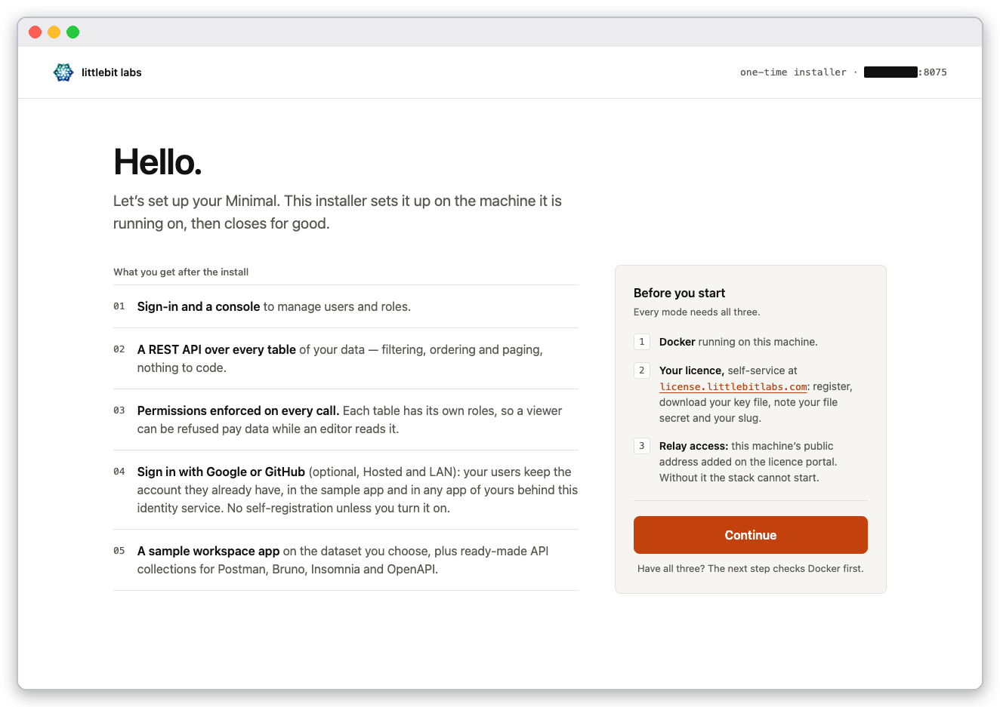
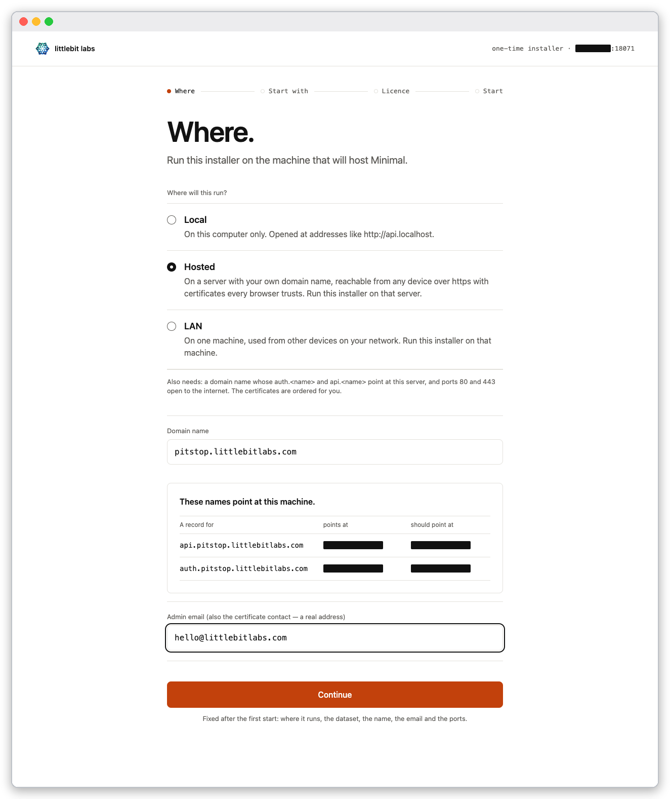
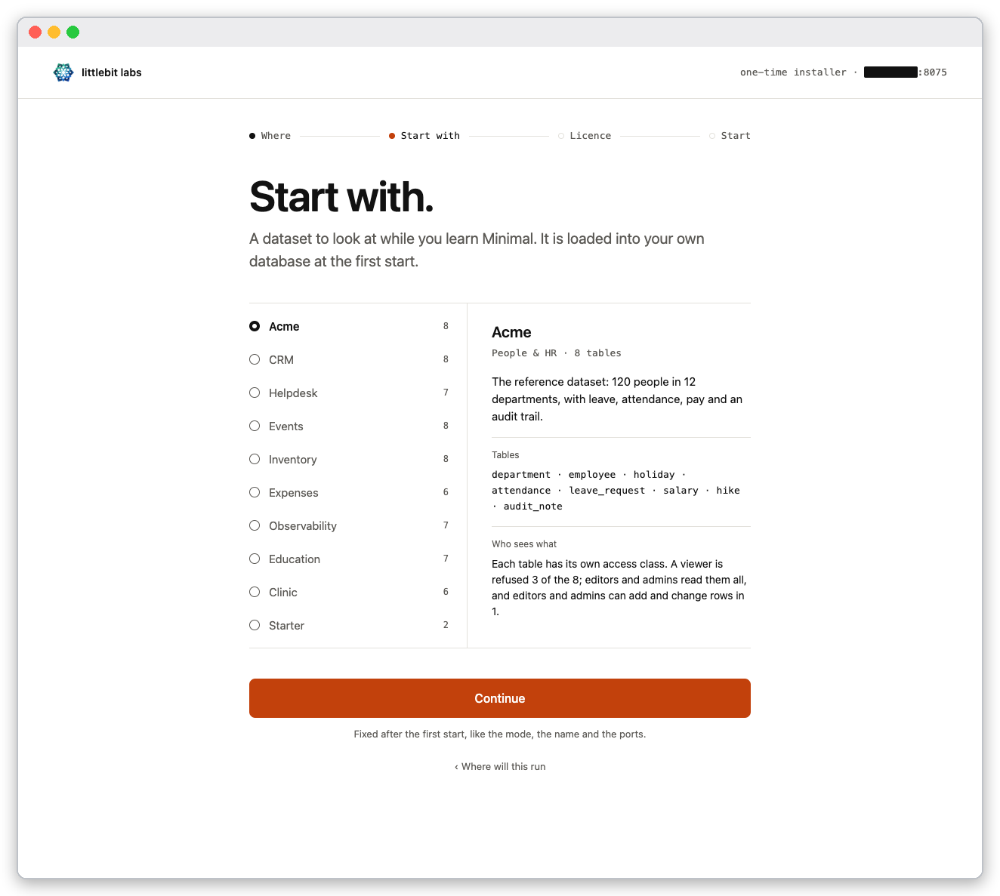
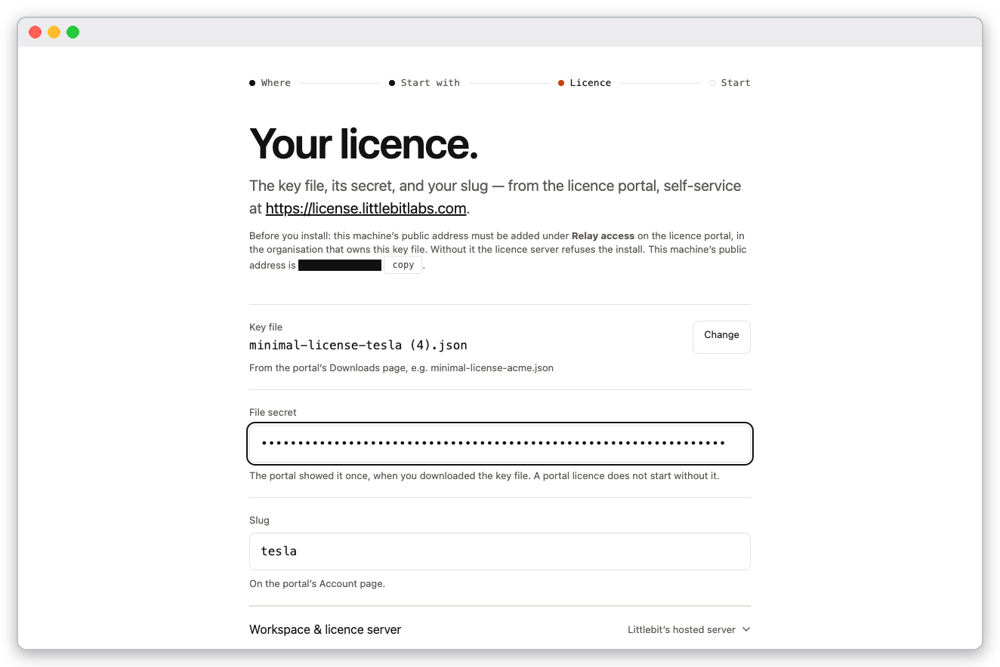
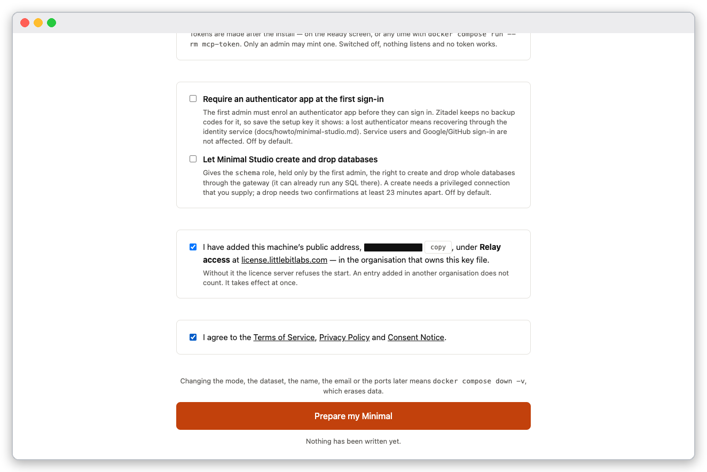
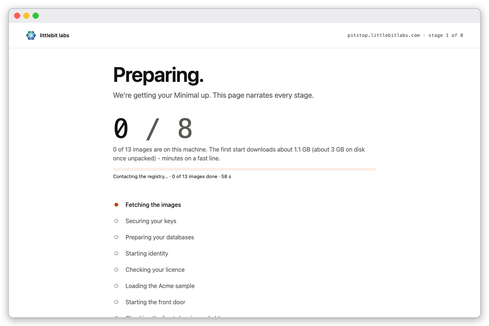
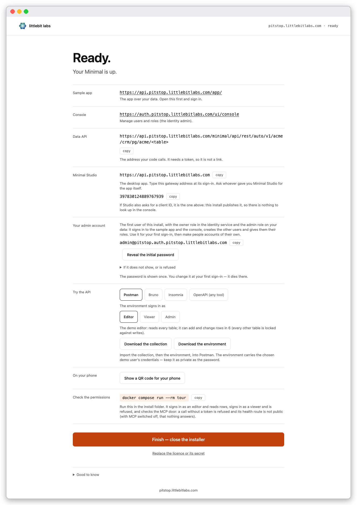
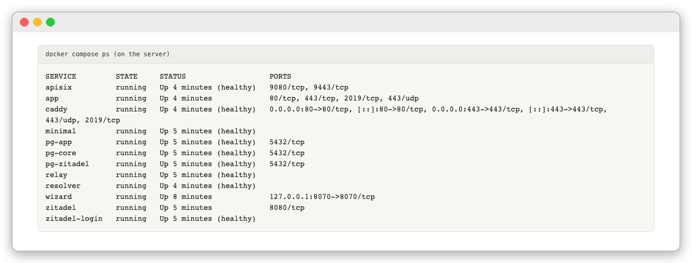
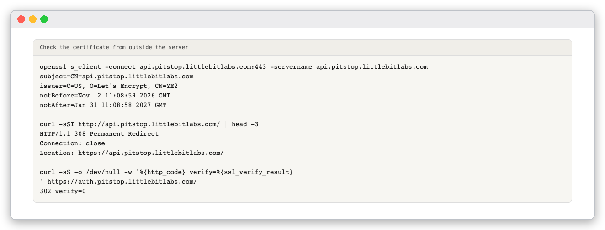
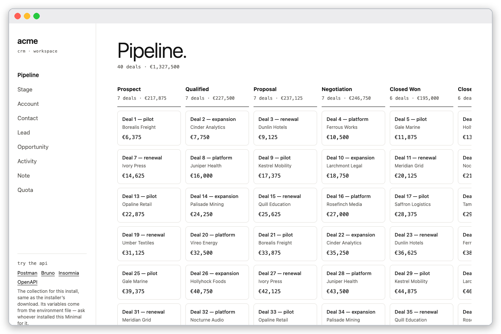

# Tutorial: put Minimal on the internet

You will install Minimal on a public server under your own domain, with real certificates from Let's Encrypt, and check from the outside that it is reachable and secure. Allow about thirty minutes, plus the time your DNS provider needs to publish two records.

This tutorial costs money: a server, a domain, and DNS records you create. The cheapest way to follow it is one small cloud server (2 vCPU and 4 GiB is enough) that you delete afterwards.

In the text the name is `pitstop.example.com` and the server's address is written `xx.yy.zz.aa`. The screenshots were taken on the author's own domain, with addresses masked; use your own name and address.

## What you need

- A server with Docker Engine 26 or later and the Compose plugin, a public address, and **both** ports 80 and 443 open to the internet. Port 80 is used to obtain the certificate; port 443 serves the stack.
- A domain name you control. Two A records must point at the server before you start:

  | Name | Type | Value |
  |---|---|---|
  | `api.pitstop.example.com` | A | `xx.yy.zz.aa` |
  | `auth.pitstop.example.com` | A | `xx.yy.zz.aa` |

- A real email address. It becomes the admin's address and the contact Let's Encrypt keeps.
- Your key file, secret and slug, and the server's public address added under **Relay access** in the licence portal (https://license.littlebitlabs.com — self-service, sign in with Google or GitHub), in the organisation that owns the key file.
- Nothing in front of the server: no load balancer, CDN or proxy. IPv6-only hosts and renaming after the first start are not supported.

Check the records from your own machine:

```bash
dig +short api.pitstop.example.com auth.pitstop.example.com
```

```text
xx.yy.zz.aa
xx.yy.zz.aa
```

## 1. Start the installer on the server

On the server, make a folder, fetch the compose file and start the installer, as in [the local tutorial](install-local.md). Then tunnel from your laptop and open the one-time address:

```bash
ssh -L 8070:localhost:8070 you@xx.yy.zz.aa
```

The first page is **Hello.**; press **Continue**.



*The installer's first page.*

## 2. Choose Hosted

1. On **Where will this run?** choose **Hosted**. Type your **Domain name** (`pitstop.example.com`) and the **Admin email (also the certificate contact — a real address)**.

   The page looks up both names and shows where each points. When they point at this machine it says **These names point at this machine.**

   

   *The Hosted choice with the DNS check. The addresses are masked.*

2. Choose a dataset on **Start with.** and press **Continue** (the screen is the same in every mode; the local tutorial describes the ten datasets).

   

   *The dataset list with its description panel.*

   On **Your licence.** choose the key file and enter the secret and the slug.

   

   *The licence screen; the server's public address is masked.*

3. On the review screen tick **Relay access** and the agreement, then press **Prepare my Minimal**.

   

   *Both boxes ticked.*

4. Wait. The stages are the same eight as in the local tutorial.

   

   *The installer working through the stages.*

5. The Ready screen lists your public addresses, all under `https://`.

   

   *The Ready screen on a Hosted install. The admin account is `admin@pitstop.auth.pitstop.example.com`.*

## 3. Check it from the outside

On the server:

```bash
docker compose ps
```



*The stack running.*

From any other machine, check the certificate and the redirect from port 80:

```bash
openssl s_client -connect api.pitstop.example.com:443 -servername api.pitstop.example.com </dev/null 2>/dev/null | openssl x509 -noout -subject -issuer -dates
```

```bash
curl -sSI http://api.pitstop.example.com/ | head -3
```

```bash
curl -sS -o /dev/null -w '%{http_code} verify=%{ssl_verify_result}\n' https://auth.pitstop.example.com/
```



*The issuer is Let's Encrypt, port 80 answers `308 Permanent Redirect` to https, and curl verifies the certificate (`verify=0`).*

## 4. Sign in

Sign in as in the local tutorial, at `https://auth.pitstop.example.com/ui/console`, with `admin@pitstop.auth.pitstop.example.com` and the initial password from **Reveal the initial password** or `docker compose run --rm -T admin-password`. Then open `https://api.pitstop.example.com/app/`.



*The sample app signed in over the public domain.*

## Check yourself

- `dig` returns the server's address for both names.
- The certificate's issuer is Let's Encrypt and `curl` prints `verify=0`.
- `http://api.pitstop.example.com/` answers `308` to the same address over https.
- You can sign in at the console and open the app.

If the install stops at the licence stage, the licence server refused the call. That has several causes; the usual one is that the server's address is listed in a different organisation than the key file's. Check **Relay access** in the organisation that owns the key file.

## Clean up

To remove the stack and its data, run `docker compose down -v` in the folder. Then delete the server, the two DNS records, and the server's entry under **Relay access**.

## Next

[Minimal over MCP](mcp-developer-guide.md) runs the same on a Hosted install; the only difference is the address.
