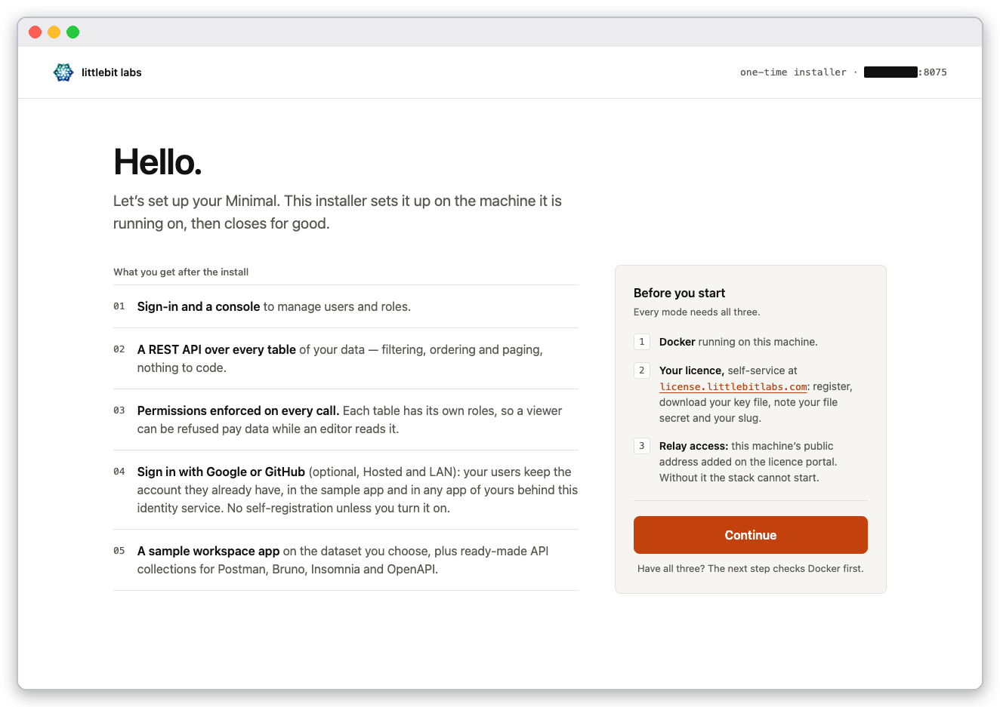
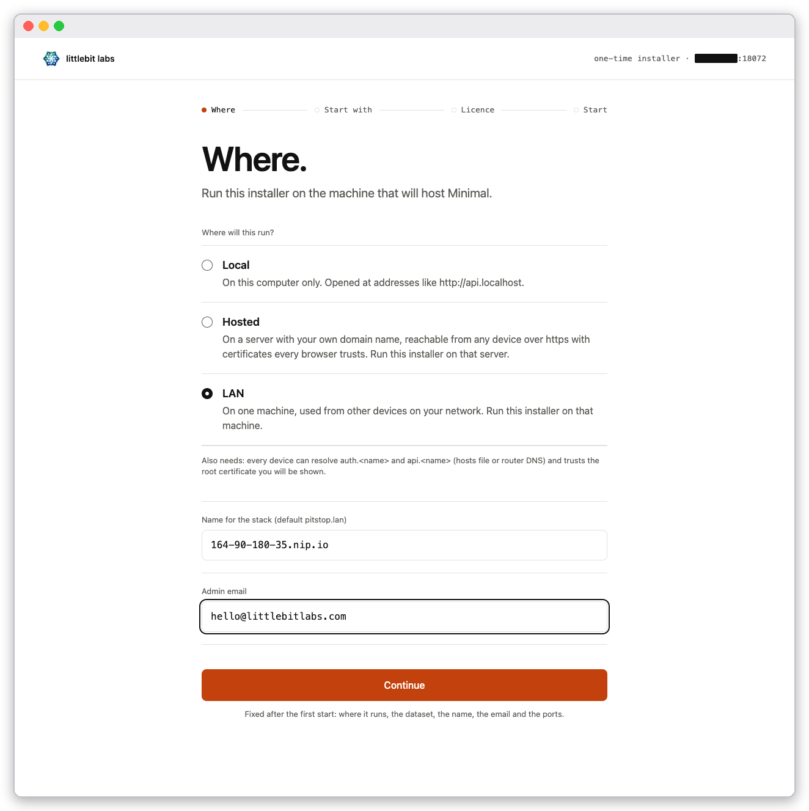
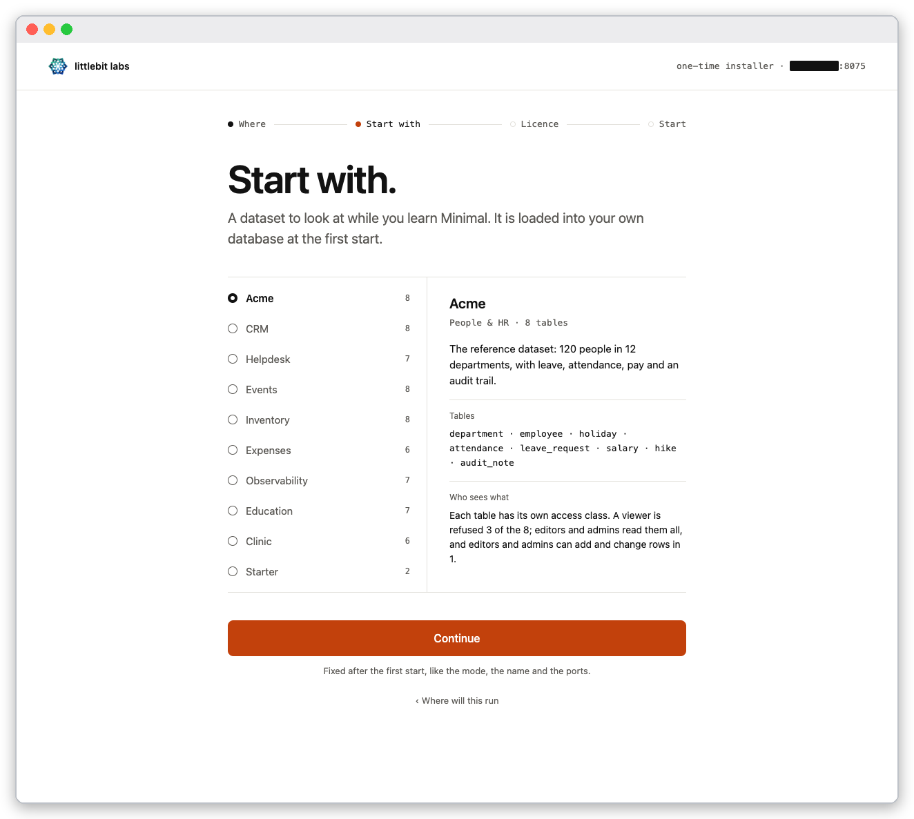
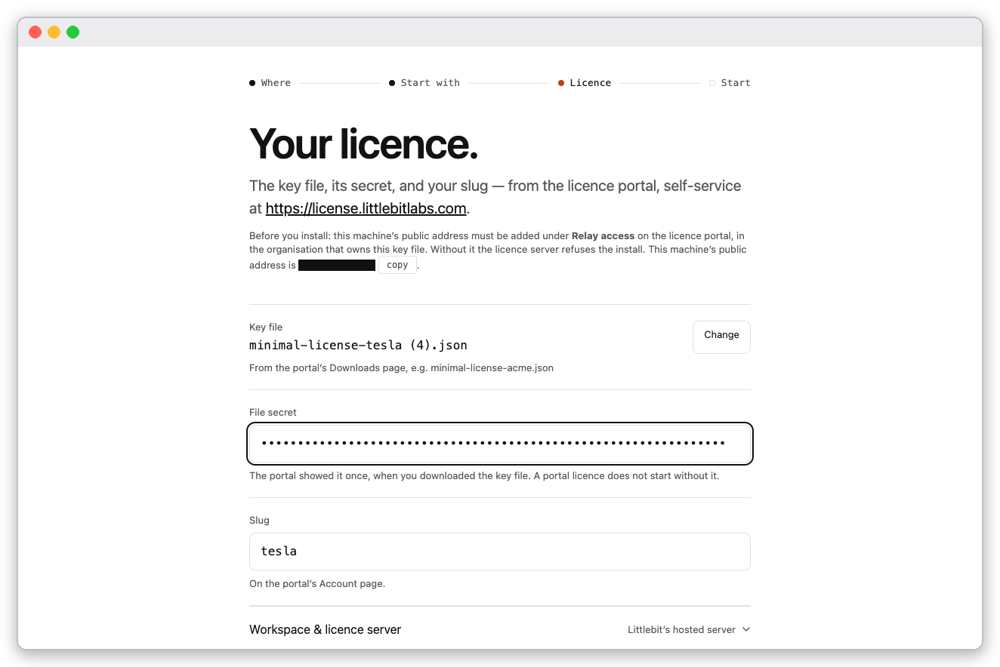
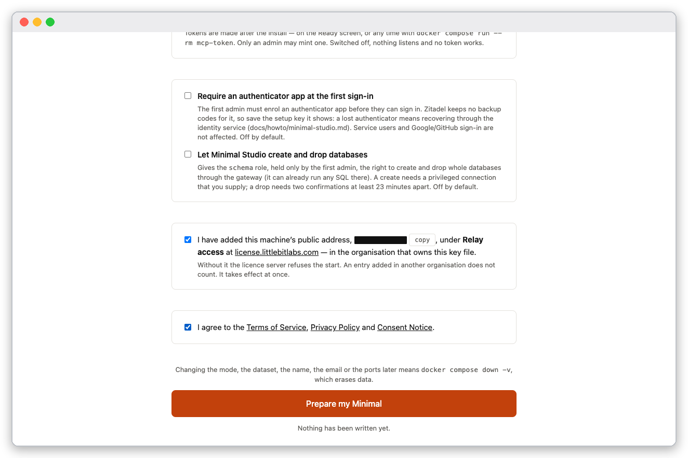
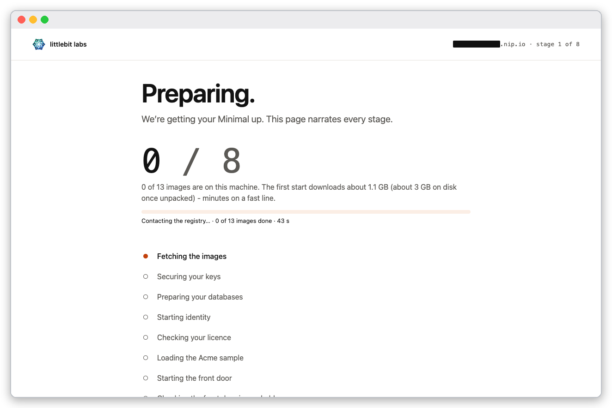
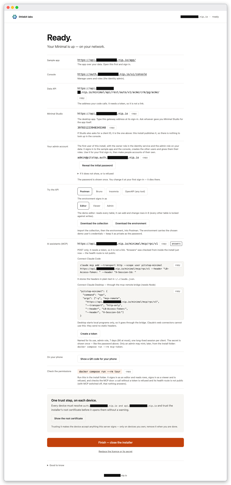
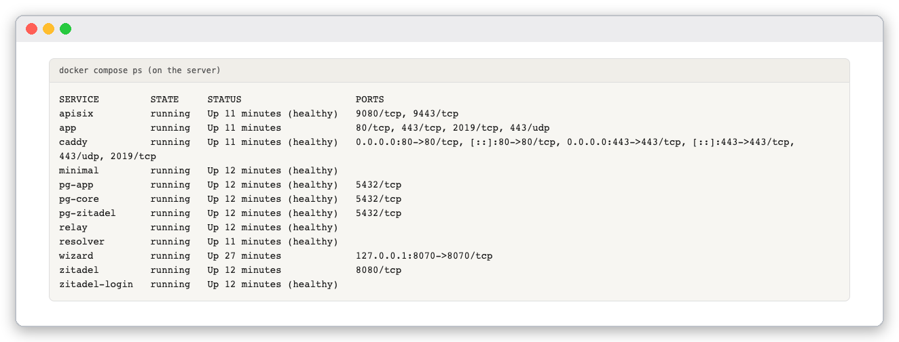
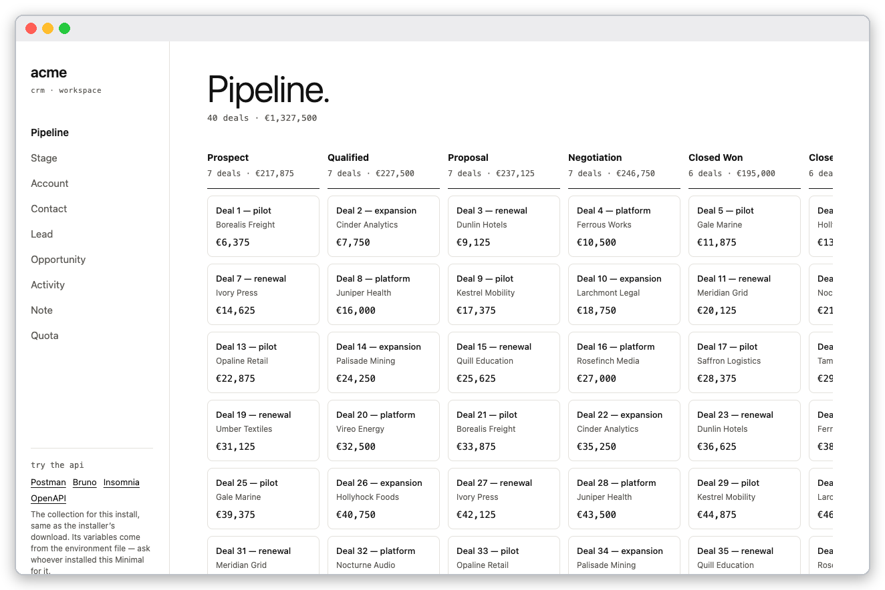
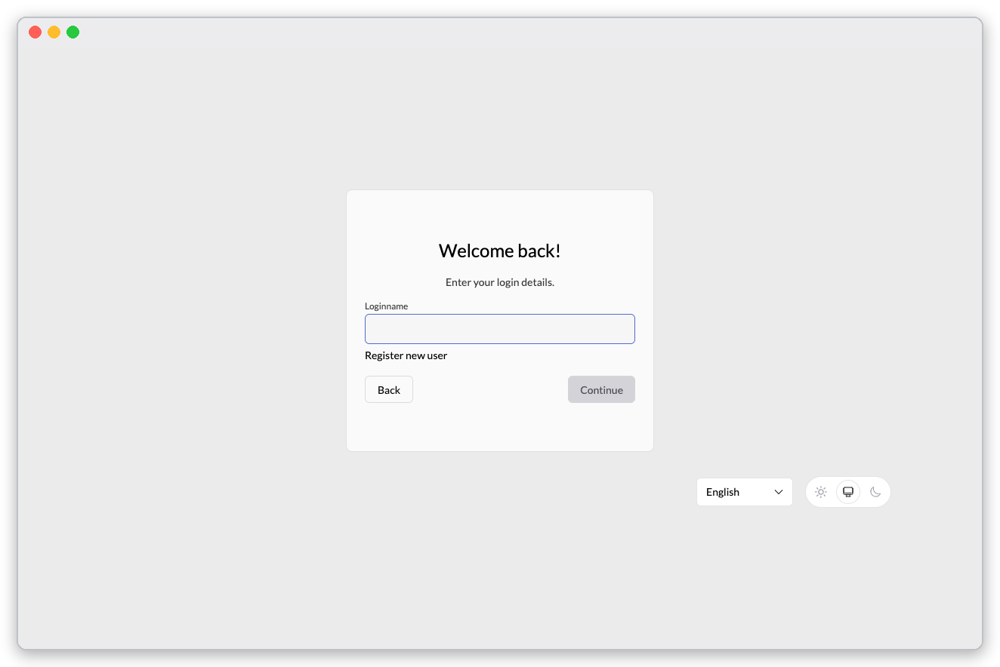

# How to run Minimal on a LAN host

Goal: one machine runs Minimal, and other devices on your network use it over HTTPS with a certificate the stack signs itself. You trust that certificate once on each device.

Use this mode when the machine is not on the internet. For a public server with a real domain, use [Put Minimal on the internet](install-hosted.md).

The screenshots were taken on a server on a private network, with its address masked. In the text the address is written `xx.yy.zz.aa`; use your machine's.

## Before you start

- A machine with Docker Engine 26 or later and the Compose plugin, ports 80 and 443 free, and the same inputs as [the local tutorial](install-local.md): key file, secret, slug, and this machine's public address under **Relay access** in the licence portal.
- A name that devices on your network resolve to the machine. The easiest is its address with dashes under `nip.io`: for `xx.yy.zz.aa` use `xx-yy-zz-aa.nip.io`. The stack then answers on `auth.xx-yy-zz-aa.nip.io` and `api.xx-yy-zz-aa.nip.io`.
- The installer must run on the machine that will host Minimal. From your laptop, tunnel to it:

```bash
ssh -L 8070:localhost:8070 you@xx.yy.zz.aa
```

## Steps

1. On the server, make the folder, fetch the compose file and start the installer, exactly as in [the local tutorial](install-local.md), then open the one-time address in your laptop's browser. The first page is **Hello.**; press **Continue**.

   

   *The installer's first page.*

2. On **Where will this run?** choose **LAN**. Type the name as **Name for the stack** and a real **Admin email**.

   

   *The LAN choice. The name is masked.*

3. Choose a dataset on **Start with.** and press **Continue** (the screen is the same in every mode; the local tutorial describes the ten datasets).

   

   *The dataset list with its description panel.*

   On **Your licence.** choose the key file and enter the secret and the slug.

   

   *The licence screen; the machine's public address is masked.*

4. On the review screen tick **Relay access** and the agreement, then press **Prepare my Minimal**.

   

   *Both boxes ticked.*

5. Wait for **Ready.** The page narrates the same eight stages as in the local tutorial.

   

   *The installer working through the stages.*

   

   *The Ready screen ends with **One trust step, on each device**, a **Show the root certificate** button and the AI assistants (MCP) address.*

6. Check the containers on the server:

   ```bash
   docker compose ps
   ```

   

   *The stack running on the server.*

## Trust the certificate on each device

A device that has not trusted the stack's root certificate refuses the connection. From a device, without the root:

```bash
curl -sS https://api.xx-yy-zz-aa.nip.io/app/
```

```text
curl: (60) SSL certificate problem: unable to get local issuer certificate
```

Get the root, check it, trust it.

1. Fetch it on the server, which also prints its SHA-256 fingerprint:

   ```bash
   docker compose run --rm -T ca-cert > pitstop-root.crt
   ```

   ```text
   SHA-256 fingerprint (compare on the device): F0:D9:1A:2B:…
   ```

   Or fetch it from the device itself at `http://auth.xx-yy-zz-aa.nip.io/pitstop-root.crt`. Both routes give the same certificate.

2. On the device, compare the fingerprint with the one printed on the server:

   ```bash
   openssl x509 -in pitstop-root.crt -noout -fingerprint -sha256
   ```

3. Trust it. On Debian or Ubuntu:

   ```bash
   sudo cp pitstop-root.crt /usr/local/share/ca-certificates/ && sudo update-ca-certificates
   ```

   On macOS, open Keychain Access, import into **System**, and set **Always Trust**. Windows, Firefox, iOS and Android have their own certificate stores; each takes the same file.

4. Check:

   ```bash
   curl -sS --cacert pitstop-root.crt -o /dev/null -w '%{http_code}\n' https://api.xx-yy-zz-aa.nip.io/app/
   ```

   ```text
   200
   ```

Trusting the root makes the device accept anything this server signs. Do it only on devices you own, and remove it when you are done.

## Sign in

Sign in exactly as in the local tutorial, with the console at `https://auth.xx-yy-zz-aa.nip.io/ui/console` and the login name `admin@pitstop.auth.xx-yy-zz-aa.nip.io`.



*The sample app signed in, served over the stack's own HTTPS.*



*The login-name page on the LAN name.*

## Verify

- `docker compose ps` shows `caddy`, `minimal`, `resolver` and `relay` as `running (healthy)`.
- The `curl` without the root fails with `(60)`; with `--cacert` it prints `200`.
- The fingerprint printed by `ca-cert` equals the one `openssl` prints on the device.

## Roll back

`docker compose down -v` stops the stack and erases its data. The mode, name and email are fixed at the first start, so changing them means this reset.
