# Tutorial: install Minimal on your own computer

You will install the whole Minimal stack on one machine with Docker, using a browser installer, and finish by signing in to a sample CRM that runs on it. Allow about fifteen minutes; the first start downloads the images.

The screenshots show a Mac. The screens are the same on Linux.

## What you need

- Docker Engine 26 or later with the Compose plugin (`docker compose version`), and ports 80 and 443 free on this machine.
- Your licence key file and its secret, and your slug, from https://license.littlebitlabs.com (self-service — sign in with Google or GitHub).
- This machine's public address added under **Relay access** in the licence portal, in the organisation that owns the key file. Without it the licence server refuses the install.
- You accept the [Terms of Service](https://littlebitlabs.com/company/terms), [Privacy Policy](https://littlebitlabs.com/company/privacy) and [Consent Notice](https://littlebitlabs.com/company/consent-notice). The installer asks you to tick a box that says so.

Placeholders in this guide: `<your-key-file>.json` is the key file you downloaded and `<your-secret>` is its secret. Neither is ever typed into a command line here.

## Get your licence (once)

The licence is self-service. Sign in at https://license.littlebitlabs.com with **Continue with Google** or **Continue with GitHub** — the portal has no passwords and reads only your name and email.

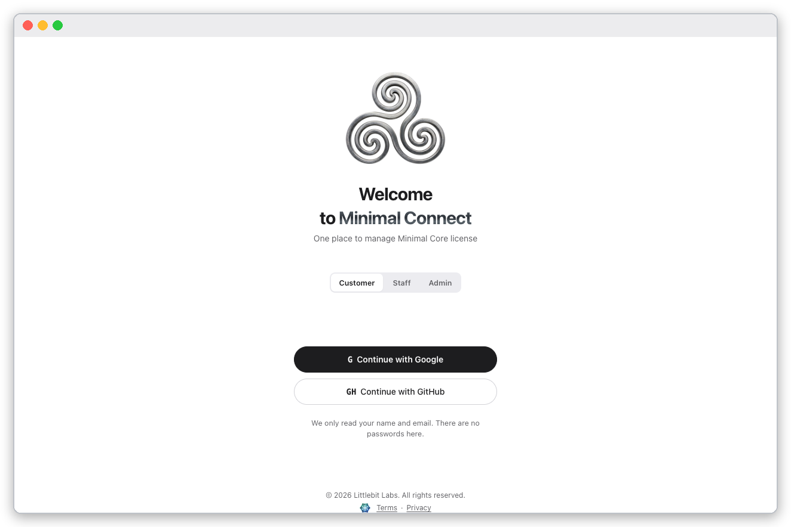

*The sign-in page: the **Customer** tab, then Google or GitHub.*

Once signed in, three pages matter. The screenshots mask the signed-in person and every address.

1. **Account** shows your **Slug**, marked **Permanent**. You type it into the installer.

   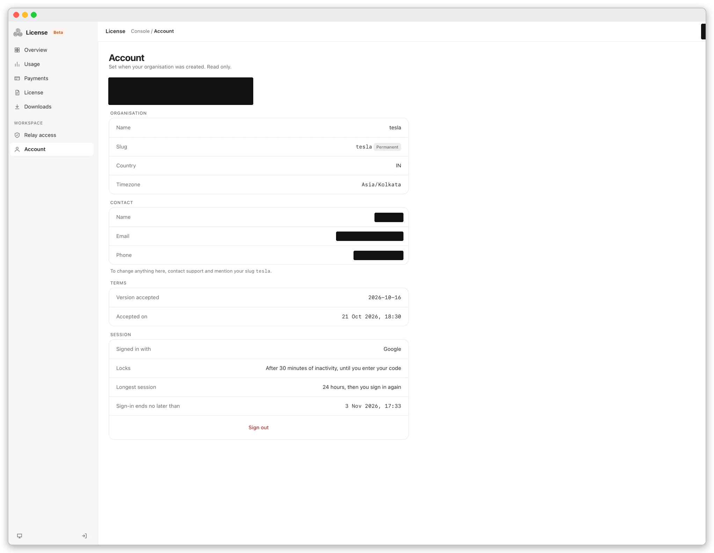

   *The Account page. The organisation's slug is permanent; to change anything else, contact support and mention it.*

2. **License** shows the licence's product, dates and status. Press **Download license file** to get `minimal-license-<slug>.json`. The **License secret** is shown once, when you download the file, and never again; **Replace secret** issues a new one if you lose it. The file stays valid.

   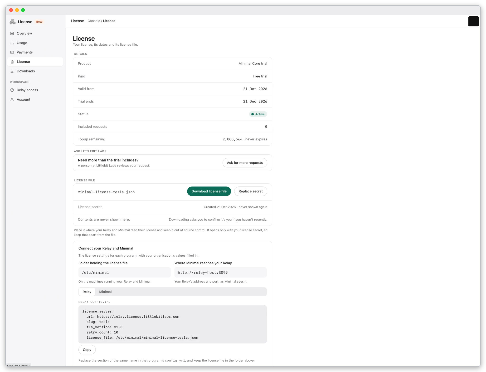

   *The License page with the **Download license file** and **Replace secret** buttons.*

3. **Relay access** lists the addresses your installation may connect from. Any other address is refused. Add this machine's public address here before you install. **Add this address** fills in the public address of the browser you are using; that is the machine's address only when the browser and the stack leave through the same address. Otherwise type the address, or a range, under **Address or range**, give it a **Label** and press **Add address**. A refused attempt appears under **Refused addresses** with an **Add** button.

   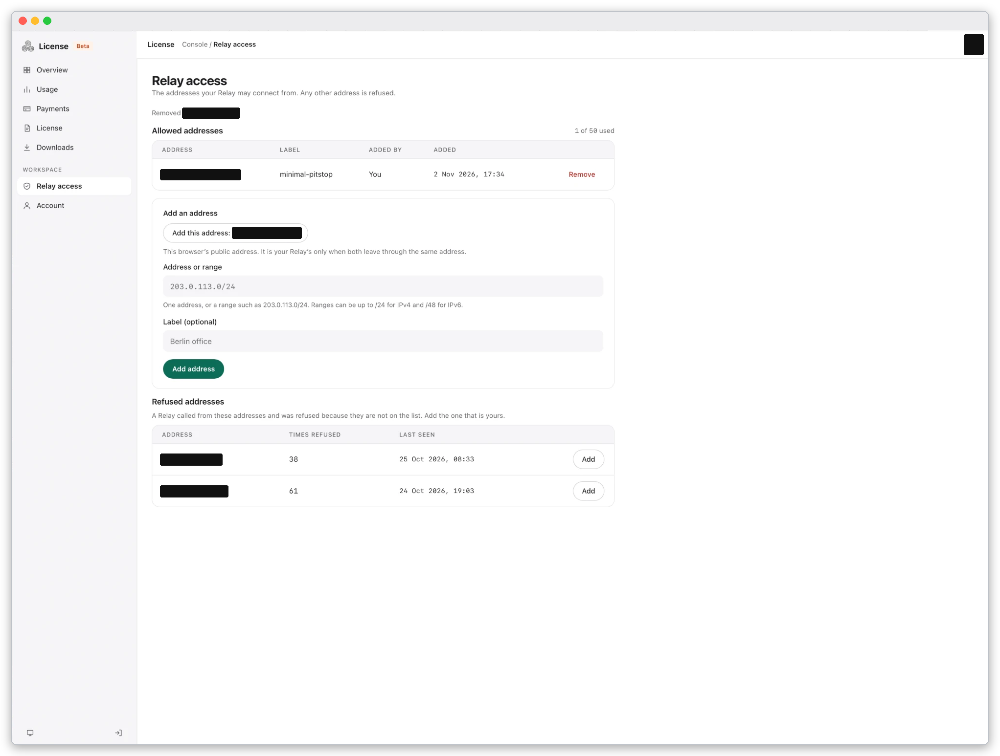

   *The Relay access page. You can list up to 50 addresses.*

Keep the key file and its secret apart: the file opens only with the secret.

## 1. Fetch the compose file and start the installer

Make a folder under your home directory and run every `docker compose` command from it.

```bash
mkdir pitstop && cd pitstop && mkdir licence
```

```bash
curl -fsSL --proto '=https' --proto-redir '=https' -o docker-compose.yml \
  https://artifacts.littlebitlabs.com/api/packages/littlebitlabs/generic/compose/0.3.6/docker-compose-v0.3.6.yml
```

```bash
docker compose up wizard
```

The installer prints a one-time address that looks like `http://localhost:8070/?token=…`. Open it in a browser on this machine. The address is valid for this run of the installer only.

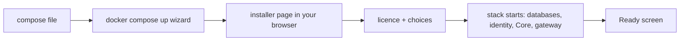

*From the compose file to the Ready screen.*

## 2. Choose where it runs

1. The first page is **Hello.** It lists what you get after the install: sign-in and a console to manage users and roles, a REST API over every table, permissions enforced on every call, optional Google or GitHub sign-in (Hosted and LAN), and a sample workspace app with API collections for Postman, Bruno, Insomnia and OpenAPI. **Before you start** lists the three things every mode needs: Docker running on this machine, your licence, and this machine's public address added under Relay access. Press **Continue**; the next step checks Docker first.

   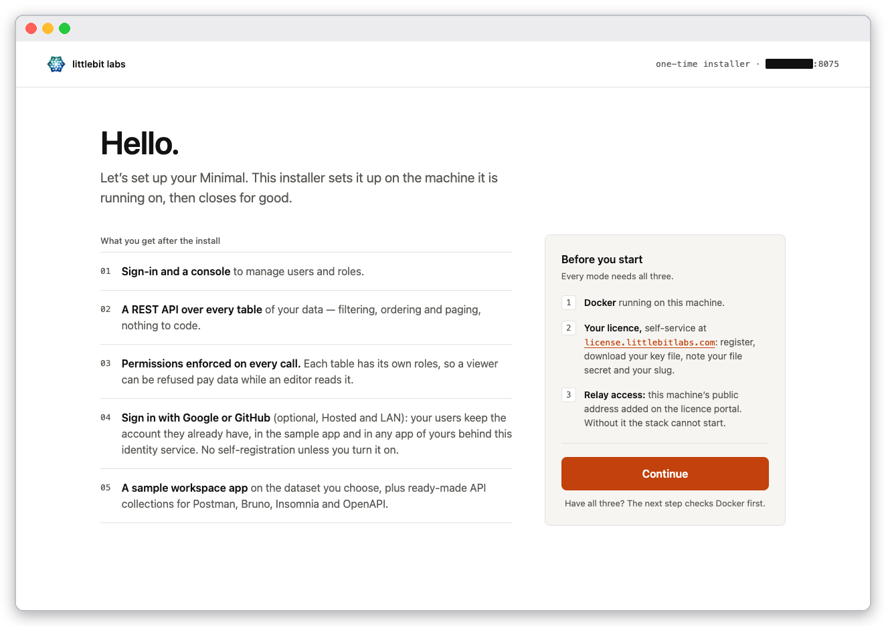

   *The installer's first page, **Hello.***

2. Under **Where will this run?** choose **Local**, then **Continue**. Local means this computer only; the stack answers at addresses like `http://api.localhost`.

   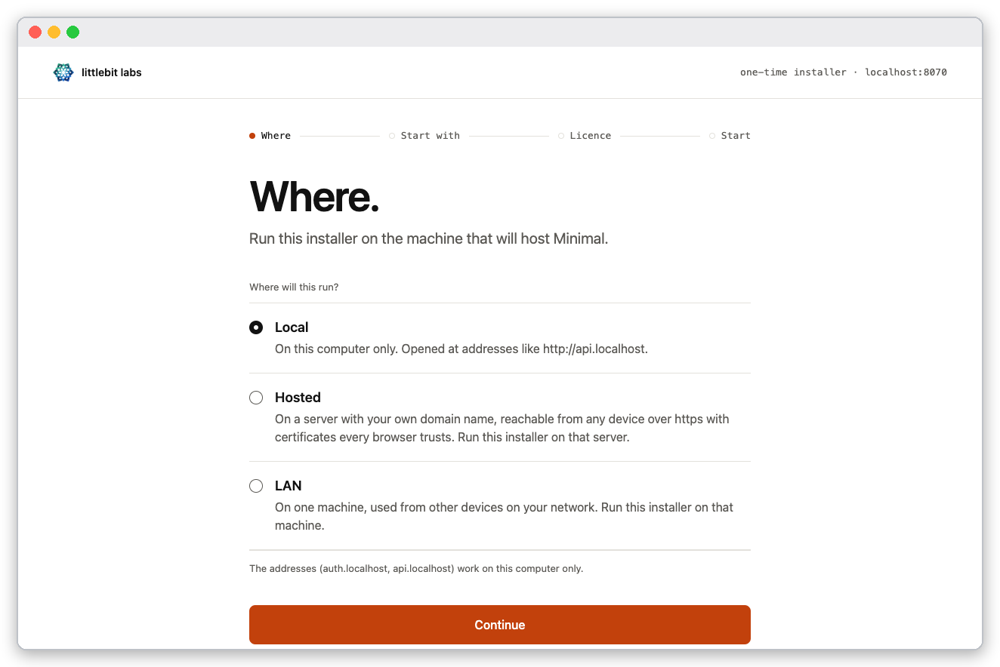

   *Local selected on the Where screen.*

3. **Start with.** lists ten datasets. Pick one to look at while you learn Minimal; it is loaded into your own database at the first start. Beside the list the page describes the one you have selected: its area, its tables, and **Who sees what**.

   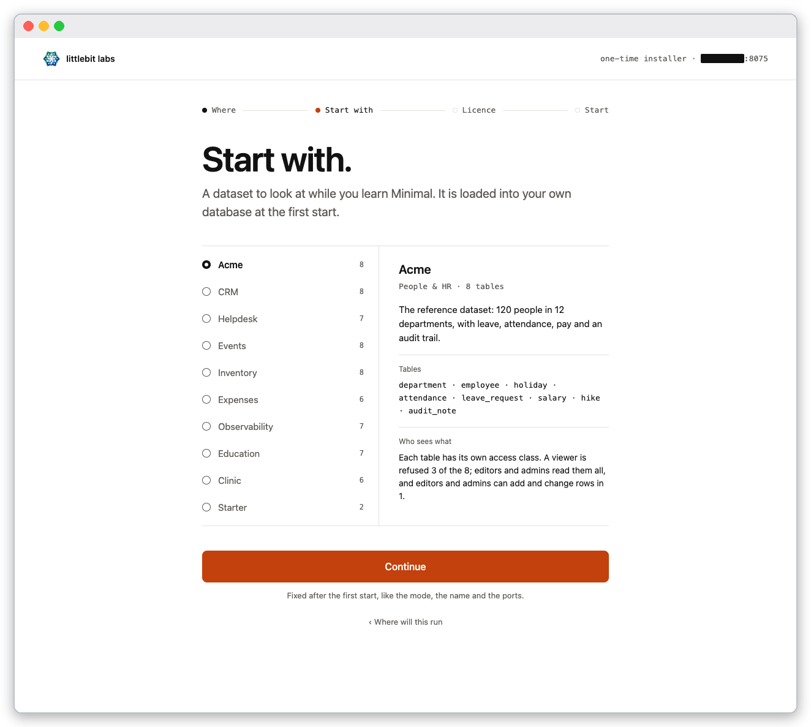

   *The ten datasets (the number beside each is its table count): Acme, CRM, Helpdesk, Events, Inventory, Expenses, Observability, Education, Clinic and Starter. Acme is selected first.*

   Select **CRM**. The panel says **Customers & pipeline · 8 tables**, lists the tables, and explains the access classes: each table has its own, a viewer is refused 1 of the 8, and editors and admins read them all and can add and change rows in 6. Then press **Continue**.

   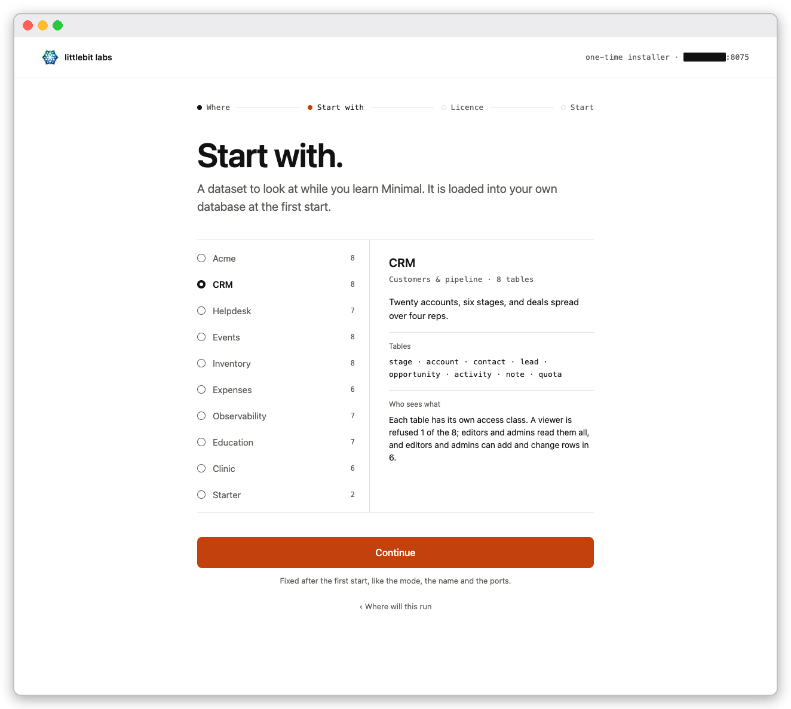

   *The CRM dataset: twenty accounts, six stages, and deals spread over four reps.*

   The dataset is fixed at the first start, like the mode, the name and the ports. Changing it later means `docker compose down -v`, which erases data.

## 3. Give it your licence

4. On **Your licence.** choose your key file, paste the **File secret**, and type your **Slug**. The page shows this machine's public address (masked in the screenshot) so you can add it under **Relay access**.

   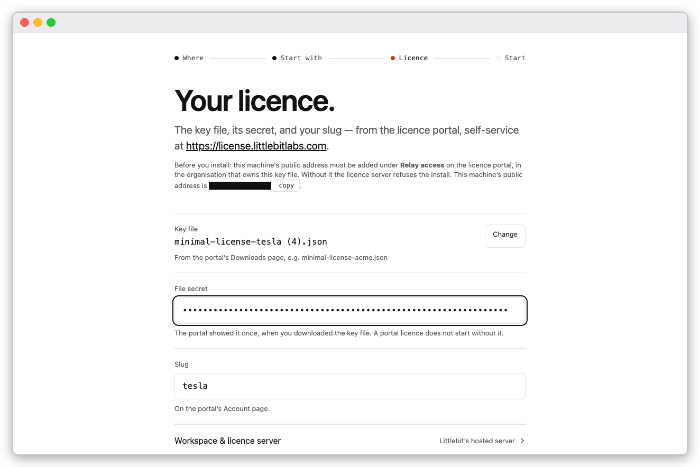

   *The licence screen with a key file chosen. The secret shows as dots.*

5. Press **Continue**. On the review screen tick the **Relay access** box and the box that begins **I agree to the Terms of Service**. **Prepare my Minimal** stays off until both are ticked.

   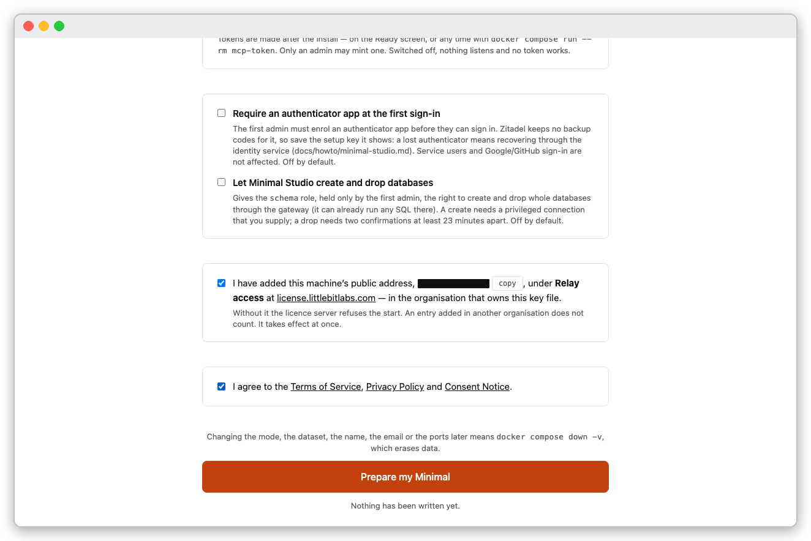

   *Both boxes ticked; the button is on.*

6. Press **Prepare my Minimal**. The page narrates eight stages: **Fetching the images**, **Securing your keys**, **Preparing your databases**, **Starting identity**, **Checking your licence**, **Loading the** sample, **Starting the front door** and **Checking the front door is reachable**.

   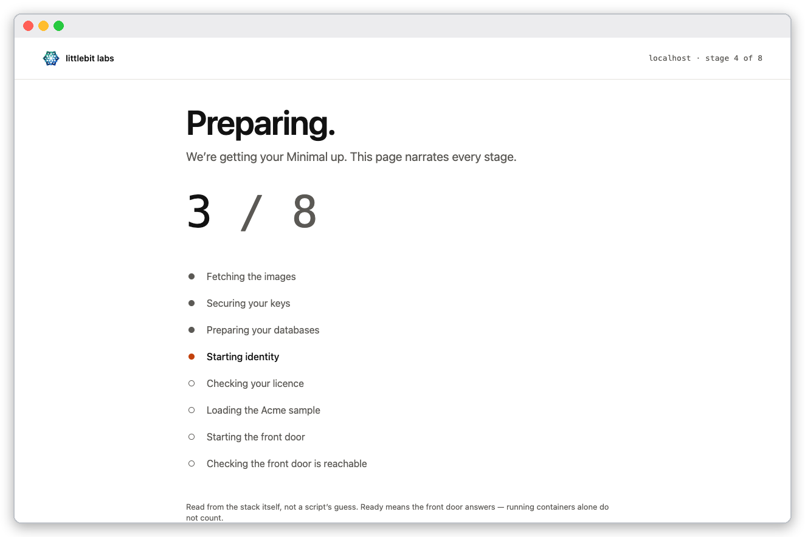

   *Stage four of eight: the page counts the stages and marks the current one.*

7. When the last stage passes, the page says **Ready.**

   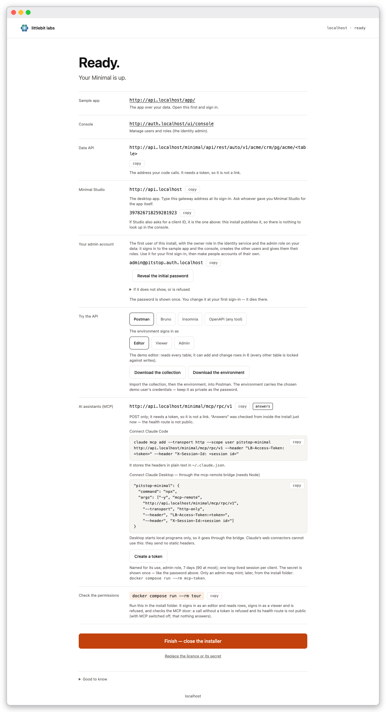

   *The Ready screen lists every address, your admin account, API collections and the MCP address.*

## 4. Check the containers

In your folder:

```bash
docker compose ps
```

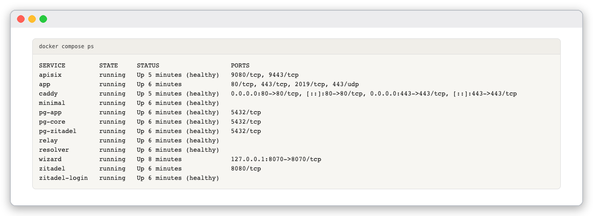

*Twelve services running. The installer container stays until you press **Finish — close the installer** on the Ready screen.*

Services with a health check show `(healthy)`. `app` and `zitadel` have none by design.

## 5. Sign in

The first user is the admin: `admin@pitstop.auth.localhost`. Its initial password is shown once by **Reveal the initial password** on the Ready screen. To read it later, from your folder:

```bash
docker compose run --rm -T admin-password
```

8. Open the console address from the Ready screen, `http://auth.localhost/ui/console`, and type the login name.

   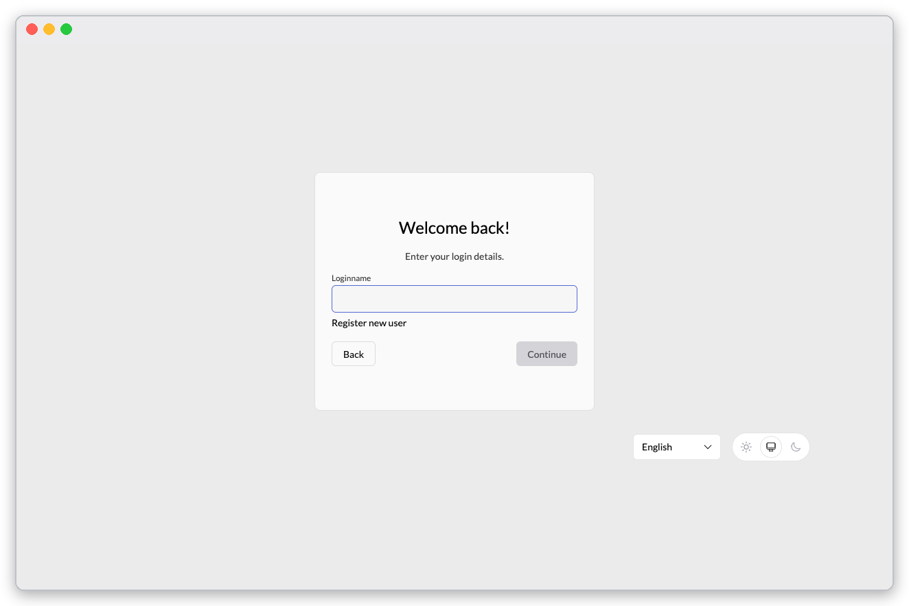

   *The login-name page.*

9. Type the initial password.

   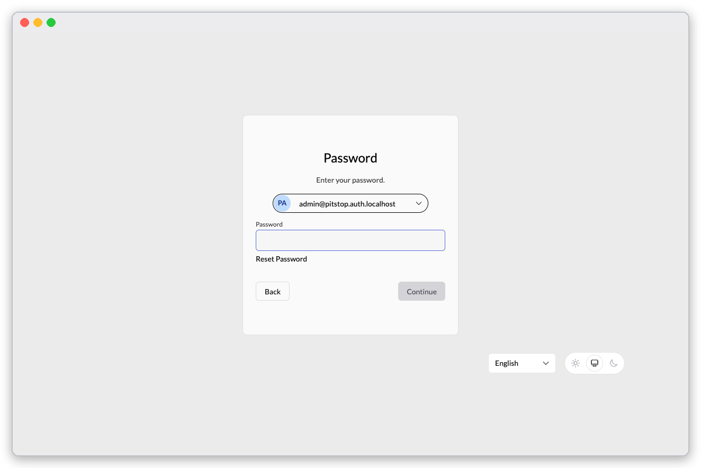

   *The password page; the password is masked in the screenshot.*

10. The first sign-in forces a new password: at least 8 characters with a symbol, a number, an uppercase and a lowercase letter. The page ticks each rule as you meet it.

    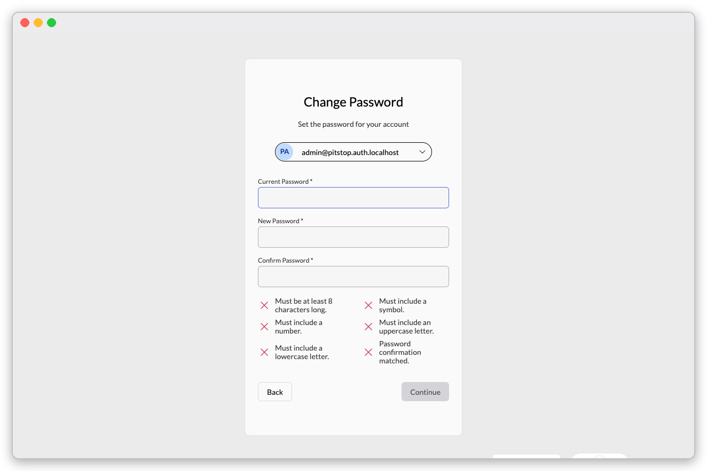

    *The change-password page with no rule met yet.*

11. After the change the identity console opens.

    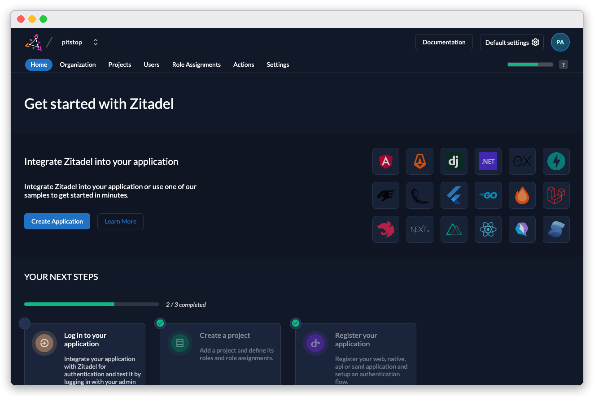

    *The identity console, where you manage users and roles.*

12. Open the sample app at `http://api.localhost/app/` and press **Sign in**. You land on the pipeline of the CRM dataset.

    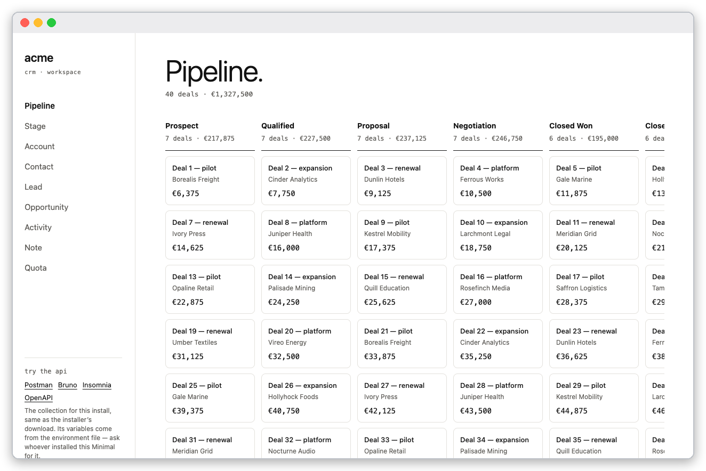

    *The sample app, signed in as the admin: forty deals in six stages.*

## Check yourself

- `docker compose ps` lists `caddy`, `minimal`, `resolver` and `relay` as `running (healthy)`.
- `http://api.localhost/app/` shows **Pipeline.** with 40 deals after you sign in.
- Signing in again with the initial password is refused; the new one works.
- The installer is still running until you press **Finish — close the installer**.

## Next

- Put the stack on your network: [Run Minimal on a LAN host](install-lan.md).
- Put it on the internet: [Put Minimal on the internet](install-hosted.md).
- Use it from an AI assistant: [Minimal over MCP](mcp-developer-guide.md).
