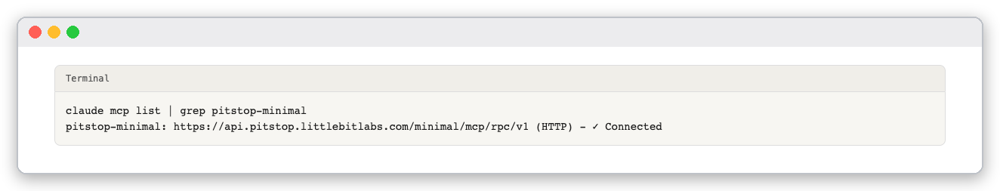
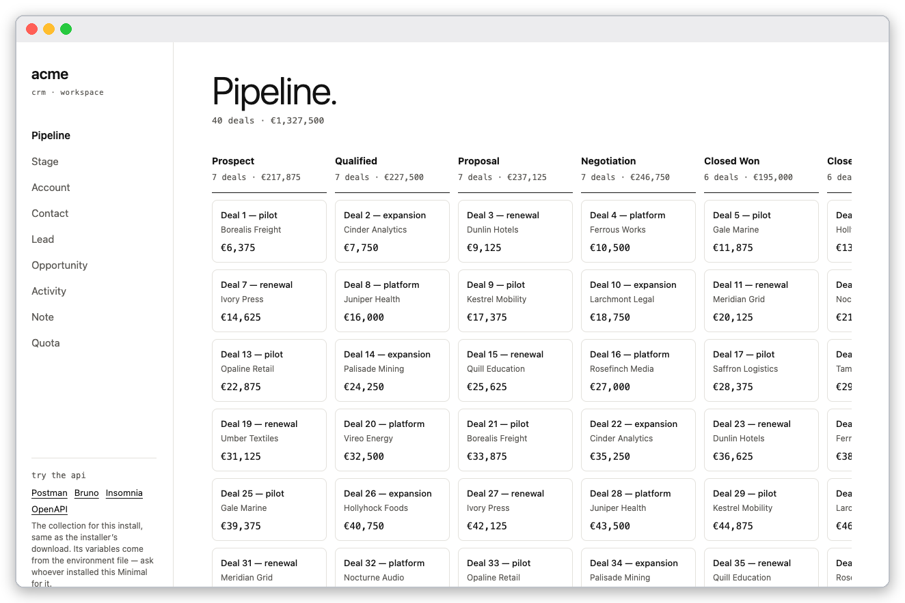
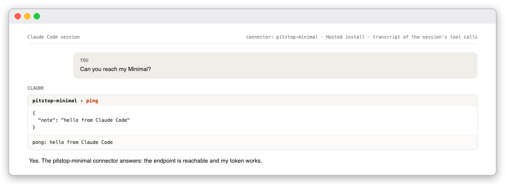
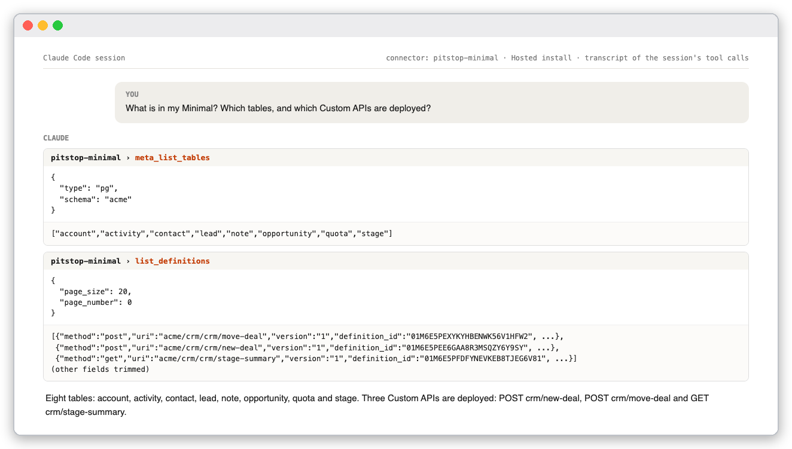
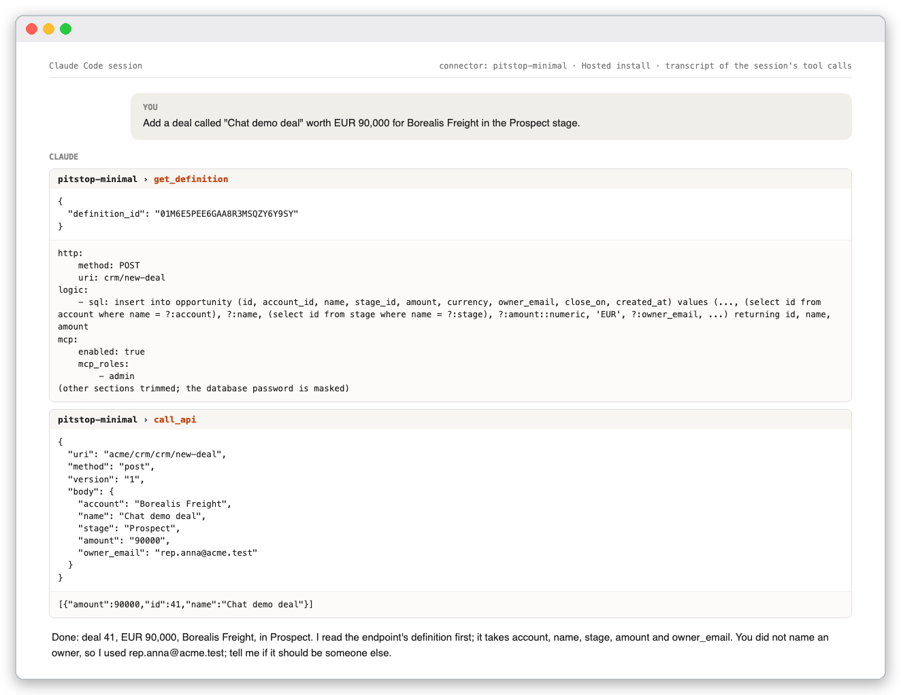
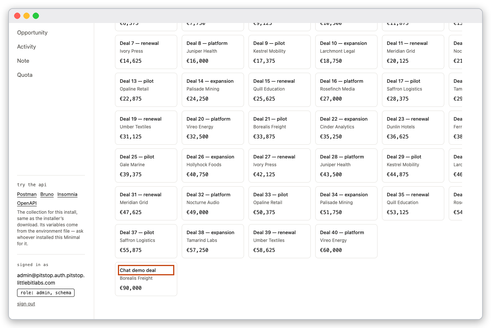
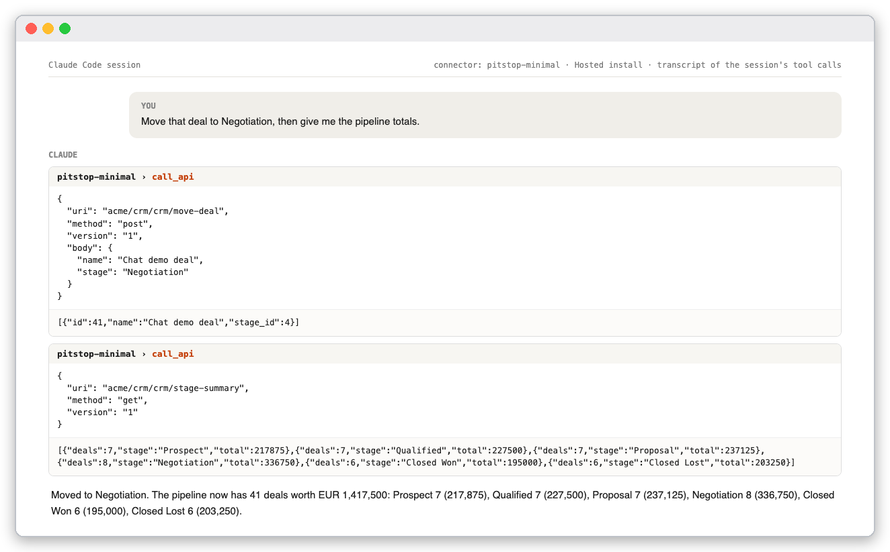
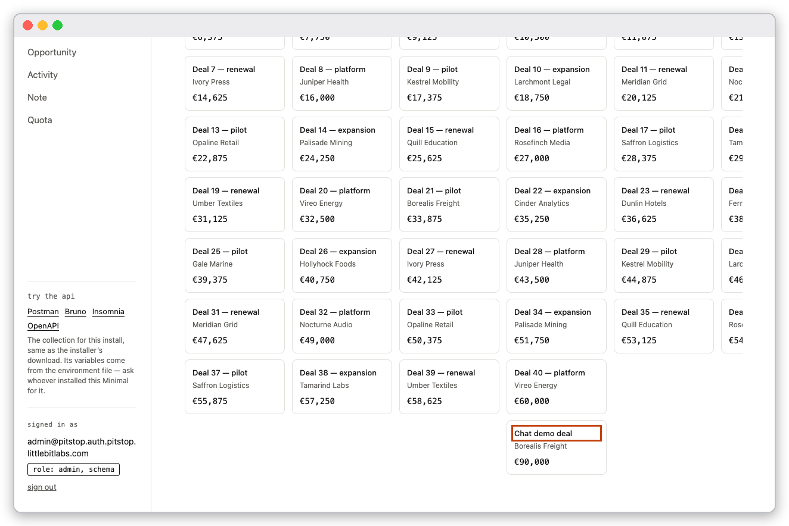
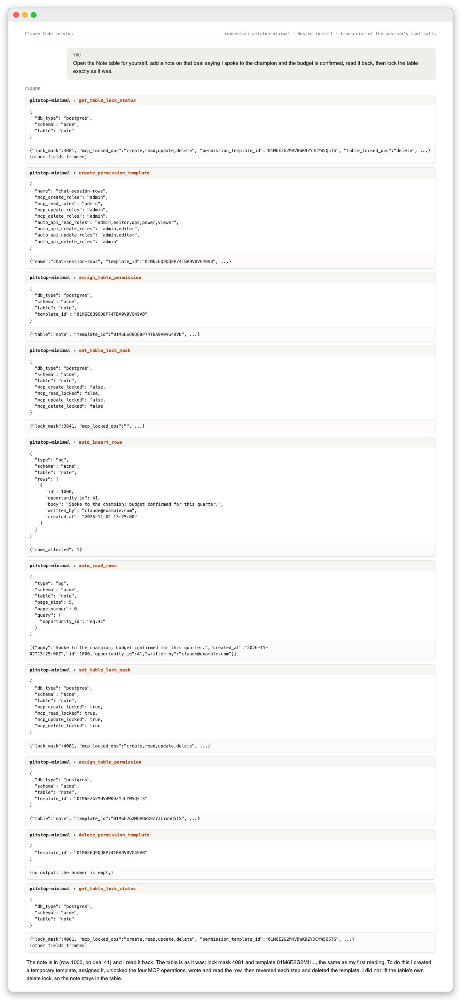
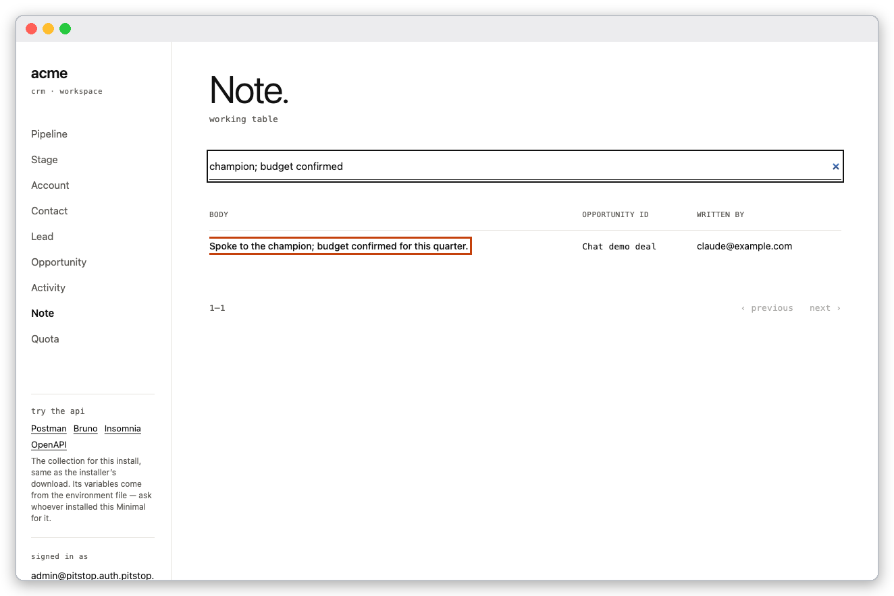

# Tutorial: work with Minimal from a Claude Code chat

You will connect Claude Code to a running Minimal and then simply ask for things: list what is there, add a record, move it, write a note. Claude picks the tools; you watch the sample app change. This is the same Minimal and the same tools as in [Minimal over MCP](mcp-developer-guide.md), which does everything with `curl`. Read that guide when you want to know exactly what each call sends.

This guide was run on a Hosted install. The chat images are transcripts of the session's tool calls, one image per prompt; the app images are screenshots of the sample app in a browser.

## What you need

- A running install with MCP on (the default), reachable by name over HTTPS: a [Hosted](install-hosted.md) install, or a [LAN](install-lan.md) one whose certificate your machine trusts. On a Local install the address `api.localhost` did not connect from Claude Code in our test, so use a LAN or Hosted install.
- An admin MCP token and its session id, from **Create a token** on the Ready screen or `docker compose run --rm -T mcp-token`.
- Claude Code installed on your machine.

Claude's web connectors cannot use this endpoint: they send no static headers, and Minimal's MCP address needs two. Claude Desktop reaches it through the `mcp-remote` bridge shown on the Ready screen.

## 1. Connect

The Ready screen prints a one-line command under **Connect Claude Code**. It looks like this, with your address, token and session id:

```bash
claude mcp add --transport http --scope user pitstop-minimal https://api.pitstop.example.com/minimal/mcp/rpc/v1 --header "LB-Access-Token: <token>" --header "X-Session-Id: <session id>"
```

Claude Code stores the two headers in plain text in `~/.claude.json`. Treat that file like a password. Check the connection:

```bash
claude mcp list | grep pitstop-minimal
```



*The server is listed and connected.*

Start a new Claude Code session so it loads the server's tools. They appear under the name `pitstop-minimal`.

## 2. Prepare the endpoints you want Claude to use

Claude changes data through Custom APIs that an operator opened to agents. Creating a Custom API needs the database password, which should never go into a chat, so you deploy these once, outside the chat, as in [the developer guide](mcp-developer-guide.md#3-deploy-a-custom-api-and-call-it). This guide uses three that work by name, so you never have to give an id:

| Endpoint | Method | Input | What it runs |
|---|---|---|---|
| `crm/new-deal` | POST | `account`, `name`, `stage`, `amount`, `owner_email` | an `insert into opportunity` that looks the account and stage up by name |
| `crm/move-deal` | POST | `name`, `stage` | an `update opportunity set stage_id = (select id from stage where name = ?:stage) where name = ?:name` |
| `crm/stage-summary` | GET | none | deals and value per stage |

Each document has `mcp.enabled: true` and `mcp_roles: [admin]`.

Open the sample app first for a baseline: 40 deals.



*The sample app before any prompt: **Pipeline.** with 40 deals.*

## 3. Talk to it

Type each prompt into the chat. Each prompt below was run in a real session.

### Check the connection

> Can you reach my Minimal?



*Claude calls `ping` and reports the endpoint reachable.*

### See what is there

> What is in my Minimal? Which tables, and which Custom APIs are deployed?



*Claude lists the eight tables and the three Custom APIs.*

### Add a record

> Add a deal called "Chat demo deal" worth EUR 90,000 for Borealis Freight in the Prospect stage.



*Claude reads the endpoint's definition to learn its inputs, then calls it. You did not name an owner, so Claude picks one and says so; check what it chose.*

The app now has the deal in **Prospect**.



*The app after the prompt: the new card, outlined in the screenshot, in the **Prospect** column.*

### Change it and summarise

> Move that deal to Negotiation, then give me the pipeline totals.



*Two calls: the move, then the summary. The totals add up to 41 deals.*



*The card is now in the **Negotiation** column.*

### Use the row tools, then put everything back

> Open the Note table for yourself, add a note on that deal saying I spoke to the champion and the budget is confirmed, read it back, then lock the table exactly as it was.



*Ten calls. Claude reads the table's lock status first, creates a temporary permission template, assigns it, unlocks the four MCP operations, inserts and reads the row, then reverses each step and deletes the template. The last call shows the same lock mask and template as the first.*



*The **Note** page, searched for the new text, shows the row Claude wrote.*

The `note` table is also locked against deletes for every caller. Claude did not lift that lock, so the note stays in the table. Ask for it if you want it gone, and remember that lifting a table's own lock is your decision.

## What to watch for

- **Claude fills in what you leave out.** It chose the deal's owner. Read the reply, not only the result.
- **A change to who may do what is a real change.** Opening a table to MCP rows, or lifting a lock, widens what an assistant can do. Ask Claude to reverse it and to prove it, as in the last prompt.
- **Every call is recorded** under the session id in your connector, and `read_my_audit_trail` returns the rows. Revoke the token when you are done: `docker compose run --rm -T mcp-token --revoke <token id>`.
- Approvals follow your Claude Code permission settings; you can approve each tool call or allow the server for the session.

## Check yourself

- `claude mcp list` shows `pitstop-minimal` as `✓ Connected`.
- After the second prompt the app shows 41 deals and a card named **Chat demo deal** in **Prospect**.
- After the third prompt the card is in **Negotiation** and the totals add up to 41 deals.
- After the last prompt the Note page lists the new note, and `get_table_lock_status` for `note` shows the same `lock_mask` as before.

## Remove it

Delete the demo rows when you are finished, remove the connector with `claude mcp remove pitstop-minimal -s user`, and revoke the token.
