# Developer guide: Minimal over MCP

An AI assistant, or any client that speaks the Model Context Protocol, can use a running Minimal as a set of tools: it can deploy a Custom API, call it, read and change rows, build an app and read the audit trail. Every call is made as one identity, with that identity's roles, and every call is recorded.

This guide works through one install, the CRM dataset, from the first call to a finished app. Each step shows the request, the answer and, where data changes, the sample app in a browser before and after. The same steps ran unchanged on a Local install, on a LAN install and on a Hosted install. Only the address and, on LAN, the trusted certificate differ.

Before you start you need a running install ([local](install-local.md), [LAN](install-lan.md) or [Hosted](install-hosted.md)), its admin account and a shell on the machine that runs it.

```mermaid
sequenceDiagram
  participant C as MCP client
  participant G as Gateway
  participant M as Minimal
  C->>G: POST /minimal/mcp/rpc/v1 (token, session id)
  G->>M: the call
  M->>M: check token, roles, locks; record the turn
  M-->>C: the tool's answer as text
```

*A call from client to Minimal. Who you are comes from the token alone; no header you send can override it.*

## 1. Connect

An MCP token is minted by an admin, once, and shown once. On the Ready screen press **Create a token**, or from the install folder:

```bash
docker compose run --rm -T mcp-token
```

The command prints the MCP address, a token and a session id. The token is named for its use, carries the admin role and lasts seven days. Put the two values in a file only you can read:

```text
LB-Access-Token: <token>
X-Session-Id: <session id>
Content-Type: application/json
Accept: application/json, text/event-stream
```

```bash
chmod 600 headers.txt
```

Keeping the headers in a file keeps the token out of your shell history and process list. The address is `http://api.localhost/minimal/mcp/rpc/v1` on a Local install and `https://api.<your-name>/minimal/mcp/rpc/v1` on LAN and Hosted. On LAN add `--cacert pitstop-root.crt` to every `curl` below, with the root certificate from [the LAN guide](install-lan.md).

List the tools:

```bash
curl -sS -H @headers.txt -X POST http://api.localhost/minimal/mcp/rpc/v1 \
  -d '{"jsonrpc":"2.0","id":1,"method":"tools/list"}'
```

```json
{"jsonrpc":"2.0","id":1,"result":{"ttlMs":60000,"cacheScope":"private","tools":[{"annotations":{"destructiveHint":false, ...
```

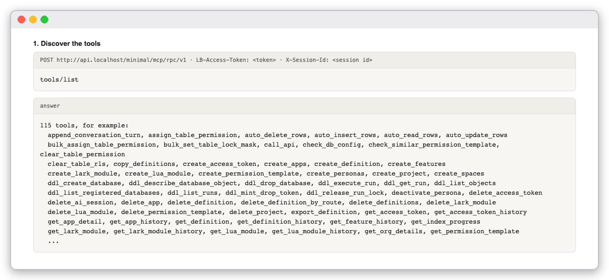

*The answer lists 115 tools. Each has a description and an input schema; read both before you call it.*

Call a tool with `tools/call`. The answer is always the tool's own reply as text:

```bash
curl -sS -H @headers.txt -X POST http://api.localhost/minimal/mcp/rpc/v1 \
  -d '{"jsonrpc":"2.0","id":1,"method":"tools/call","params":{"name":"get_org_details","arguments":{}}}'
```

```json
{"jsonrpc":"2.0","id":1,"result":{"content":[{"type":"text","text":"{\"abbreviation\":\"acme\", ...}"}]}}
```

In the rest of this guide a call is shown as the tool name and its `arguments`, and the answer as the text it returns.

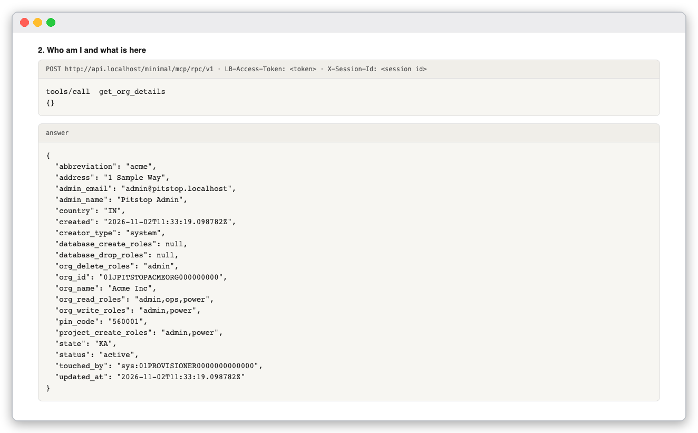

*Your organisation, read with `get_org_details`.*

## 2. Find your identifiers

A Custom API names your organisation, project, space and user. Read them from your own audit trail: every row carries them.

```json
{"name":"read_my_audit_trail","arguments":{"page_size":4,"page_number":0}}
```

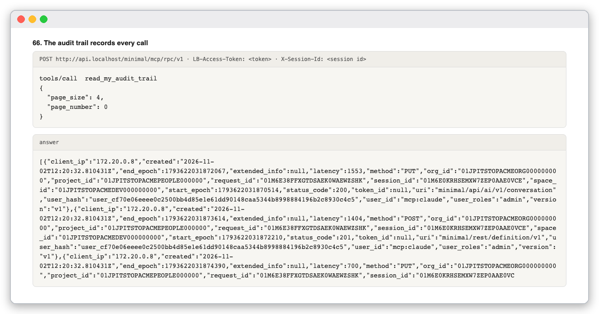

*Each row names `org_id`, `project_id`, `space_id` and `user_id`, the call's URI and its status.*

On the CRM install they are `01JPITSTOPACMEORG000000000`, `01JPITSTOPACMEPEOPLE000000`, `01JPITSTOPACMEDEV000000000` and `mcp:claude` (the token's name).

## 3. Deploy a Custom API and call it

A Custom API is an endpoint you declare in one YAML document. It names the path, the roles that may call it, the database it talks to and the steps that run. Here is one that adds a deal.

```yaml
identifiers:
  org_id: 01JPITSTOPACMEORG000000000
  project_id: 01JPITSTOPACMEPEOPLE000000
  space_id: 01JPITSTOPACMEDEV000000000
  user_id: mcp:claude
  feature_id: crm
permission:
  - admin
http:
  method: POST
  uri: crm/new-deal
  version: "1"
  input_type: json
  output_type: json
logic:
  - sql: insert into opportunity (id, account_id, name, stage_id, amount, currency, owner_email, close_on, created_at) values ((select coalesce(max(id), 0) + 1 from opportunity), ?:account_id::int, ?:name, ?:stage_id::int, ?:amount::numeric, 'EUR', ?:owner_email, now()::date + 30, now()) returning id, name, stage_id, amount
config:
  rollback_version: "1"
  coalesce: false
  cache_result: false
database:
  type: postgres
  username: acme_core
  password: <db-password>
  name: acme
  timeout_secs: 60
  idle_timeout_secs: 60
  max_open_connections: 5
  max_idle_connections: 2
  machine:
    - host: pg-app
      port: "5432"
mcp:
  enabled: true
  mcp_roles:
    - admin
```

The password is the one the installer generated for the `acme_core` database role. It is a secret; read it into a file and keep it out of chat:

```bash
docker compose run --rm -T --no-deps --entrypoint cat provision /state/pg_app_core > db-password.txt
```

Send the document to `create_definition`. The endpoint is live when the call succeeds:

```json
{"name":"create_definition","arguments":{"document":"<the YAML above, as one string>"}}
```

```json
{"definition_id": "01M6E3CTZ8KAVWCWAAKBEMABGP", "final_url": "acme/crm/crm/new-deal"}
```

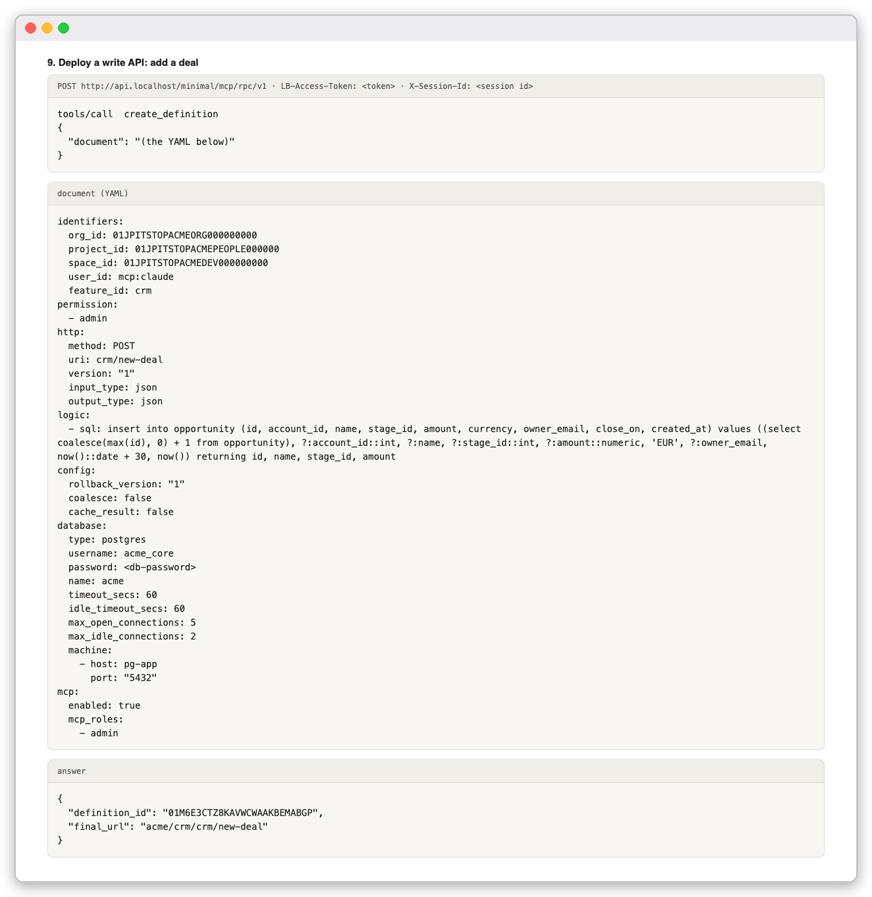

*The document and the answer. The password is masked in the screenshot.*

`final_url` is the stored path: your project's prefix is put in front of the `uri` you wrote. `call_api` takes it, a method and a version. For `post` the `body` is the endpoint's input.

```json
{"name":"call_api","arguments":{"uri":"acme/crm/crm/new-deal","method":"post","version":"1","body":{"account_id":1,"name":"MCP demo deal","stage_id":1,"amount":"125000","owner_email":"demo@example.com"}}}
```

```json
[{"amount":125000,"id":41,"name":"MCP demo deal","stage_id":1}]
```

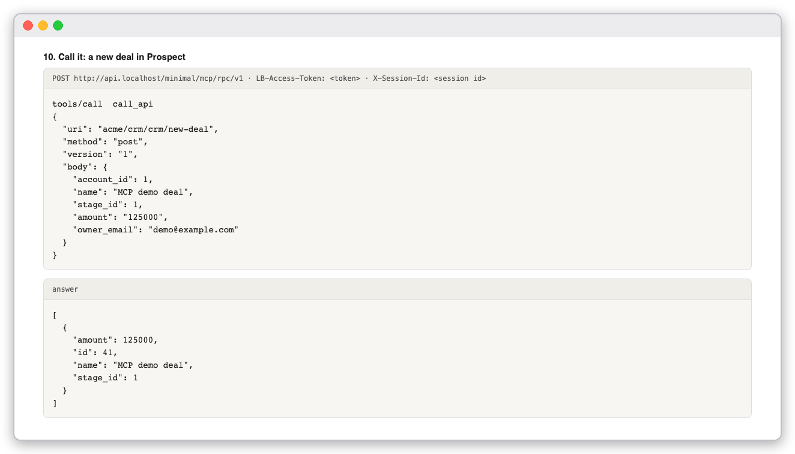

*The endpoint ran and returned the row it inserted.*

Open the sample app. Before the call it showed 40 deals; now it shows 41, and the new card is in **Prospect**.

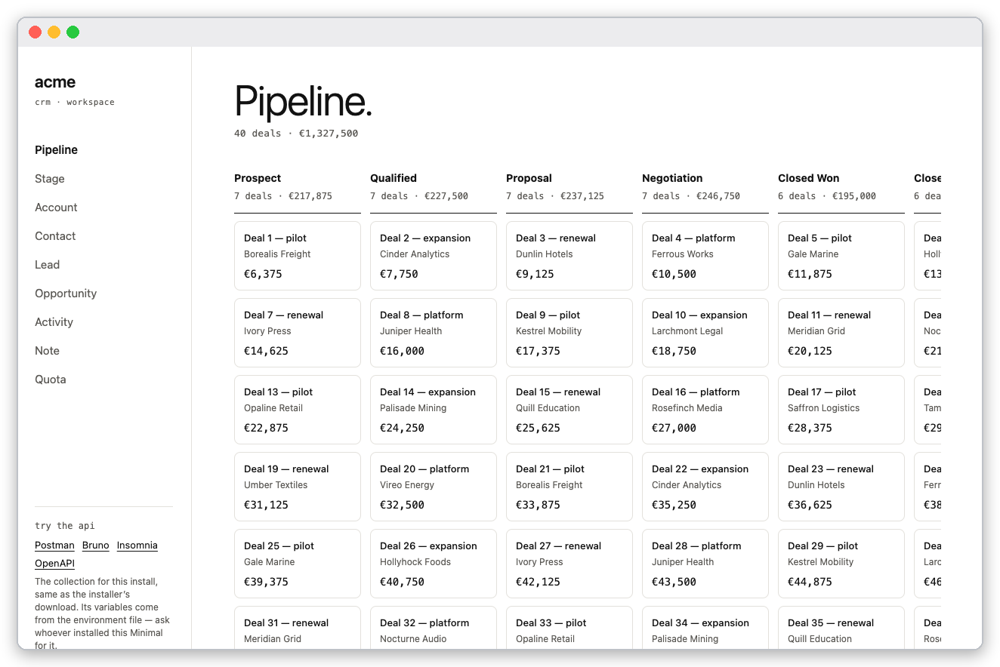

*Before: **Pipeline.** with 40 deals.*

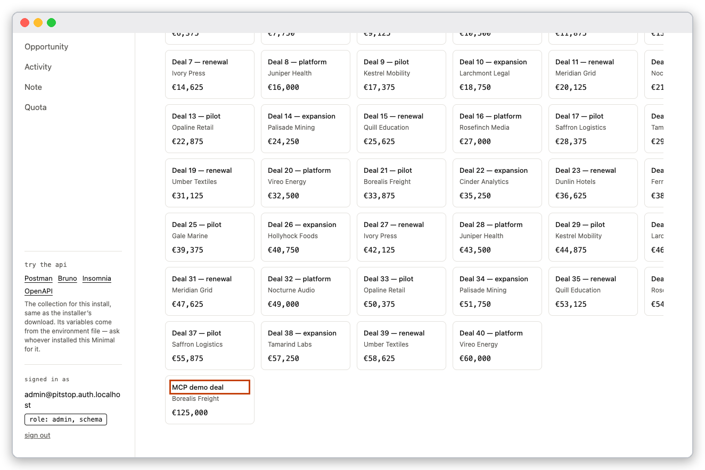

*After: the new card, outlined in the screenshot, in the **Prospect** column.*

The same call over the other two modes:

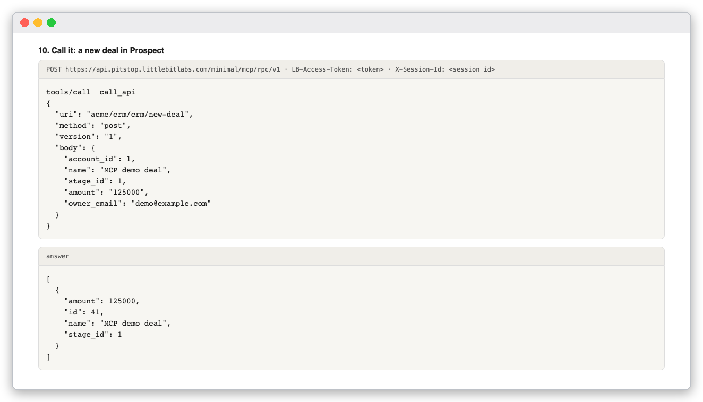

*The call on the Hosted install, over HTTPS on the public domain.*


*The call on the LAN install, with the stack's root certificate trusted.*

### What each section of the document does

- **identifiers** must name your own organisation, project, space and user exactly as your token resolves them; any other value is refused with 403. `feature_id` is stored as sent.
- **permission** lists the roles that may call the endpoint directly over REST.
- **mcp** opens the endpoint to agents. `call_api` admits a caller only when `mcp.enabled` is true and one of the caller's roles is in `mcp_roles`.
- **http** gives the method, the path, the version and the input and output types. A path and method are unique in a space; a second document on the same path and method is refused with 409.
- **logic** is an ordered list of steps. A step is `- sql: <one statement>` or `- lua: <name>` followed by `code:`. `?:name` takes the value of the input called `name`.
- **config** and **database** are mandatory. The database block is a full connection, not a reference.

### Change and manage what is deployed

Move the deal to another stage with a second endpoint. `update_definition` replaces an existing document in full, so build it from the one you sent:

```json
{"name":"call_api","arguments":{"uri":"acme/crm/crm/move-deal","method":"post","version":"1","body":{"id":41,"stage_id":4}}}
```

```json
[{"id":41,"name":"MCP demo deal","stage_id":4}]
```

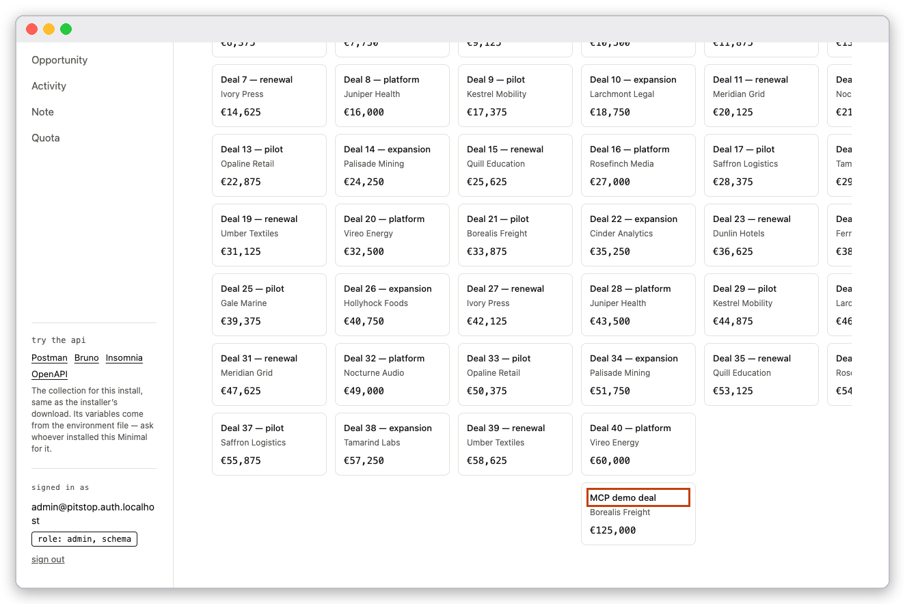

*The app after the call: the card is in **Negotiation**.*

Replace the document, then call it again:

```json
{"name":"update_definition","arguments":{"document":"<the full YAML, with a changed query>"}}
```

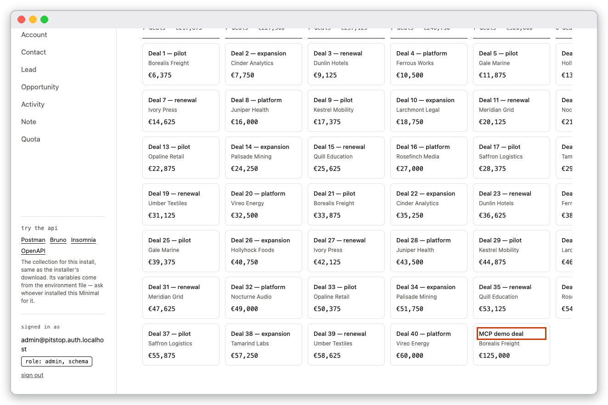

*After the replaced endpoint ran with `stage_id` 5, the card is in **Closed Won**.*

List what is deployed, filtered by tag if you like:

```json
{"name":"list_definitions","arguments":{"page_size":20,"page_number":0}}
```

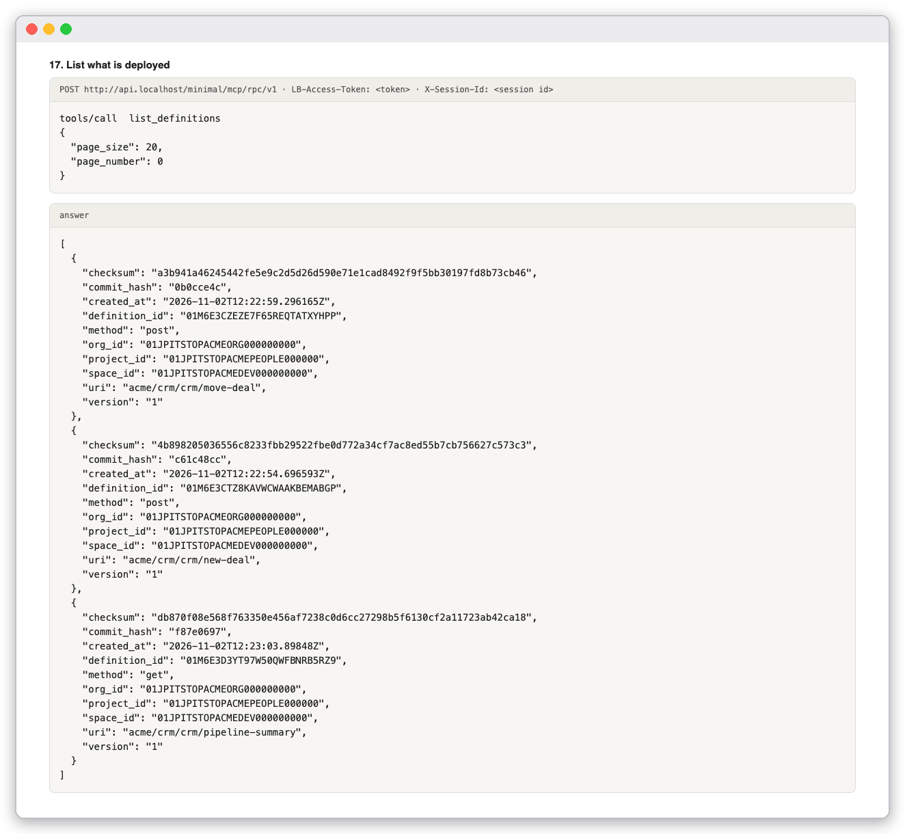

*Each row gives the URI, method, version and definition id.*

### A step in Lua

A logic step can be Lua. This endpoint sums a query's rows:

```yaml
logic:
  - sql: select s.name as stage, count(o.id) as deals, coalesce(sum(o.amount), 0) as total from stage s left join opportunity o on o.stage_id = s.id group by s.id, s.name order by s.id
    omit: true
  - lua: summarise
    code: |
      function min_main()
        local deals, total = 0, 0
        for i = 1, #step_0 do deals = deals + step_0[i].deals; total = total + step_0[i].total end
        return { stages = #step_0, deals = deals, total = total }
      end
```

`omit: true` keeps that step's rows out of the answer. Later steps read earlier ones as `step_0`, `step_1`, and so on. The function is `min_main`; it takes no arguments and returns a table.

```json
{"deals":41,"stages":6,"total":1452500}
```

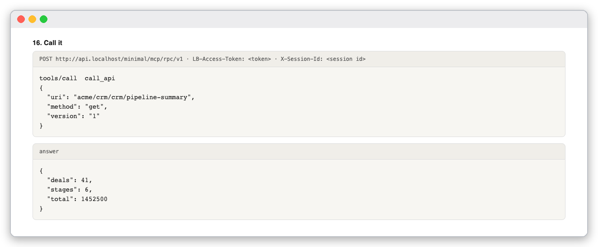

*The Lua endpoint's answer.*

### Refusals you should expect

| Call | Answer |
|---|---|
| `call_api` on an endpoint that needs an input you left out | `the API answered 424 Failed Dependency: … could not execute URI` |
| `call_api` on an endpoint whose `mcp.enabled` is false, after `patch_definition_attributes` closed it | `403 Forbidden … insufficient permissions for mcp …` |
| `create_definition` on a path and method already used | `409 Conflict`, `definition already exists` |
| `create_definition` with a document that does not compile | `400`, with the compiler's message, for example `identifier "feature_id" not found` |

## 4. Read and change rows with the Auto API

The Auto API is the generic row interface: `auto_read_rows`, `auto_insert_rows`, `auto_update_rows`, `auto_delete_rows`. Over MCP it is locked on every table at install time, so an assistant reaches your data only through endpoints you deployed. A call is refused:

```json
{"name":"auto_read_rows","arguments":{"type":"pg","schema":"acme","table":"opportunity","page_size":2,"page_number":0}}
```

```text
the API answered 403 Forbidden: {"code":403,"status":"Forbidden","message":"insufficient permissions for this operation on this table, got [admin]"}
```

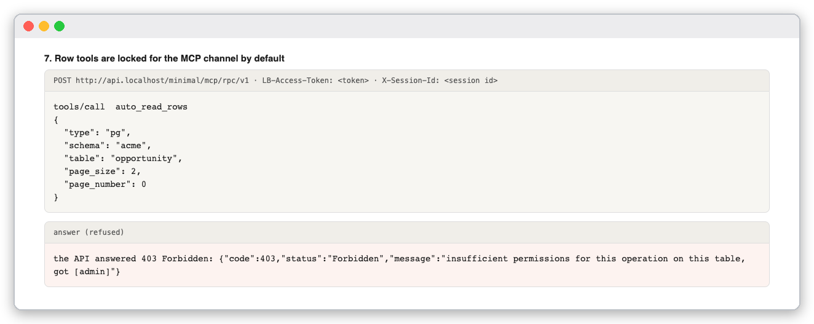

*An admin MCP session is refused: the table's lock and its permission template both have to allow the call.*

You can open one table on purpose. Two things gate a call: the table's **lock mask**, which says which operations are allowed on which channel, and the **permission template**, which says which roles may use them. Read the lock first:

```json
{"name":"get_table_lock_status","arguments":{"db_type":"postgres","schema":"acme","table":"note"}}
```

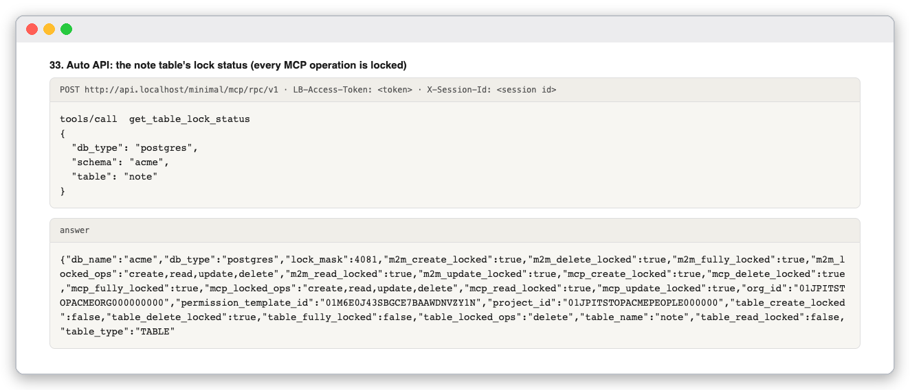

*On the `note` table every `mcp_*_locked` flag is true.*

Open the sample app's **Note** page for a baseline:

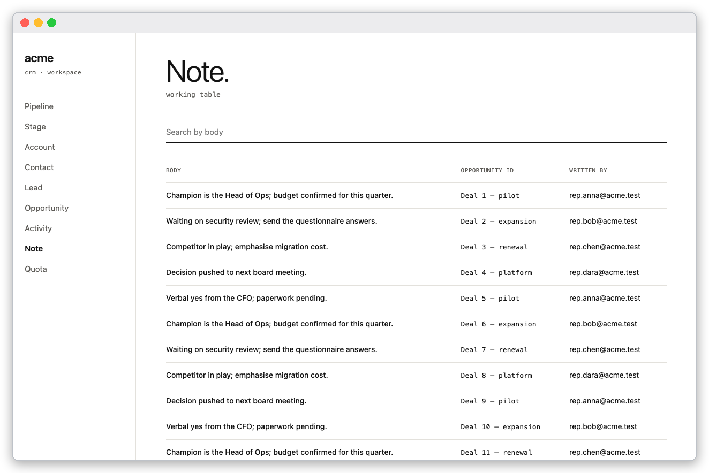

*The **Note** page before any change.*

Create a template that gives `admin` the four MCP row operations, assign it to the table, and unlock the four operations:

```json
{"name":"create_permission_template","arguments":{"name":"guide-mcp-rows","description":"admin may use the row tools over MCP","auto_api_read_roles":"admin,editor,ops,power,viewer","auto_api_create_roles":"admin,editor","auto_api_update_roles":"admin,editor","auto_api_delete_roles":"admin","mcp_create_roles":"admin","mcp_read_roles":"admin","mcp_update_roles":"admin","mcp_delete_roles":"admin"}}
```

```json
{"name":"assign_table_permission","arguments":{"db_type":"postgres","schema":"acme","table":"note","template_id":"<the template_id from the answer>"}}
```

```json
{"name":"set_table_lock_mask","arguments":{"db_type":"postgres","schema":"acme","table":"note","mcp_create_locked":false,"mcp_read_locked":false,"mcp_update_locked":false,"mcp_delete_locked":false}}
```

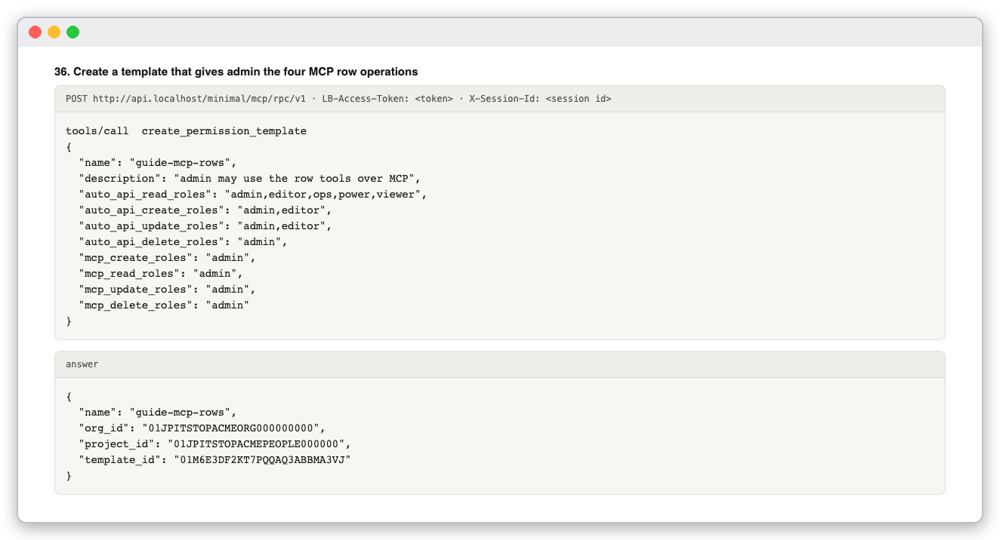

*The new template. The unlock is the call below it in the same run.*

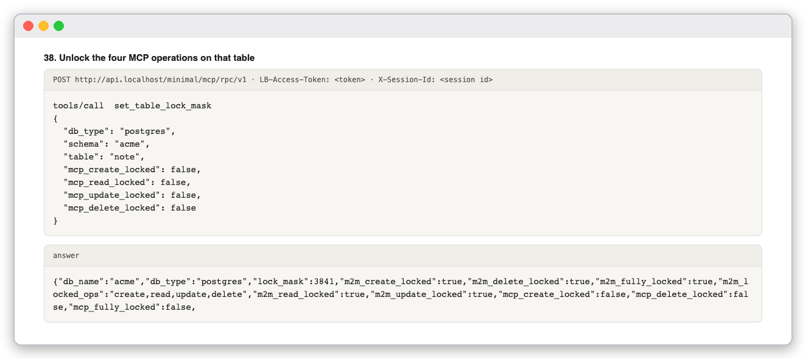

*The lock status after the unlock.*

Now the row tools work. Read, insert, update:

```json
{"name":"auto_read_rows","arguments":{"type":"pg","schema":"acme","table":"note","page_size":3,"page_number":0}}
```

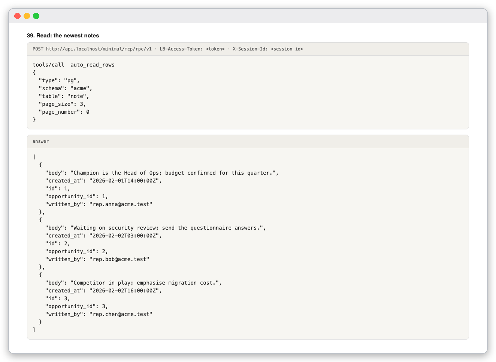

*The first three notes.*

```json
{"name":"auto_insert_rows","arguments":{"type":"pg","schema":"acme","table":"note","rows":[{"id":1000,"opportunity_id":1,"body":"Written by an agent through MCP","written_by":"agent@example.com","created_at":"2026-11-02 12:00:00"}]}}
```

```json
{"rows_affected": 1}
```

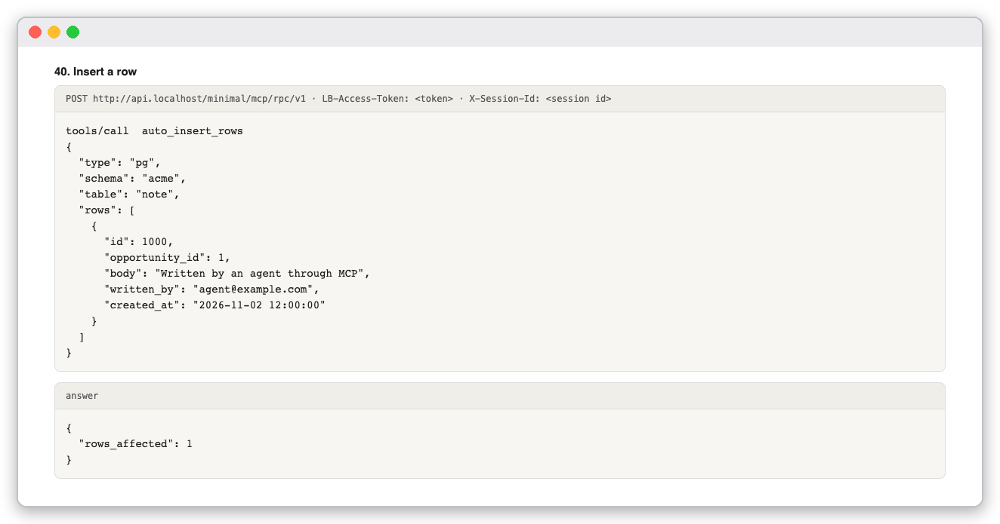

*One row inserted.*

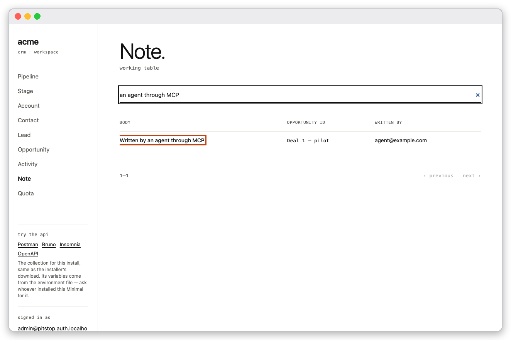

*The **Note** page, searched for the new text, shows the row the assistant wrote.*

`set` is a list of `column.value` pairs and `query` says which rows: a key is a column and its value is `operator.operand`, here `eq.1000`.

```json
{"name":"auto_update_rows","arguments":{"type":"pg","schema":"acme","table":"note","set":"body.Edited by an agent through MCP","query":{"id":"eq.1000"}}}
```

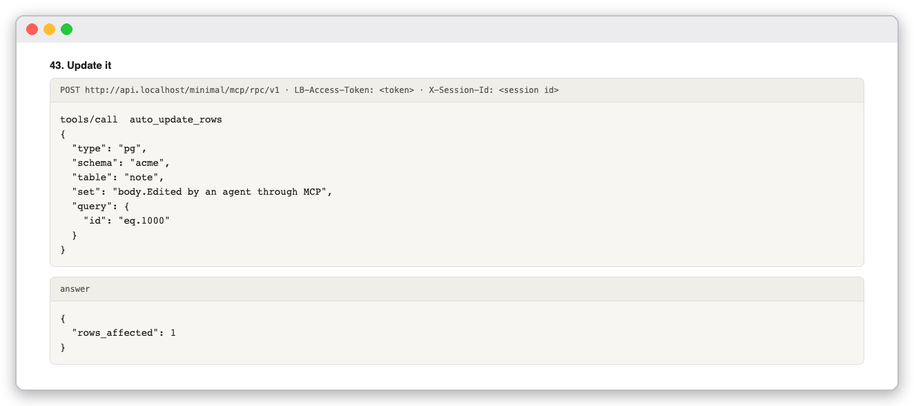

*One row updated.*

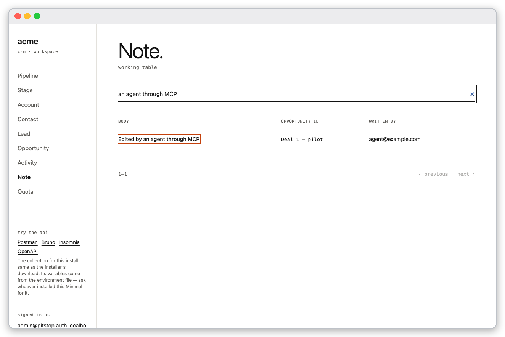

*The edited text in the app.*

A delete is refused here, and not by the MCP lock. The `note` table is locked against deletes for every caller, over every channel:

```text
the API answered 403 Forbidden: {"code":403,"status":"Forbidden","message":"insufficient permissions for this operation on this table, got [admin]"}
```

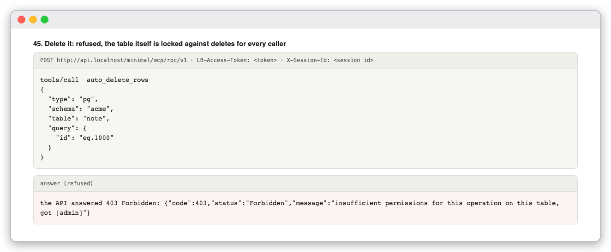

*The table's own delete lock.*

That lock is the owner's decision. Lift it for the demonstration, delete, and see the row go:

```json
{"name":"set_table_lock_mask","arguments":{"db_type":"postgres","schema":"acme","table":"note","table_delete_locked":false}}
```

```json
{"name":"auto_delete_rows","arguments":{"type":"pg","schema":"acme","table":"note","query":{"id":"eq.1000"}}}
```

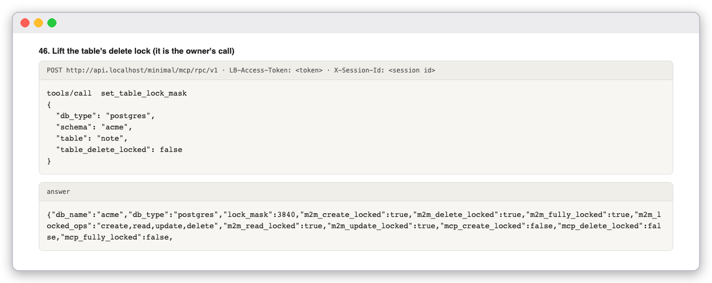

*The lock status with deletes allowed.*

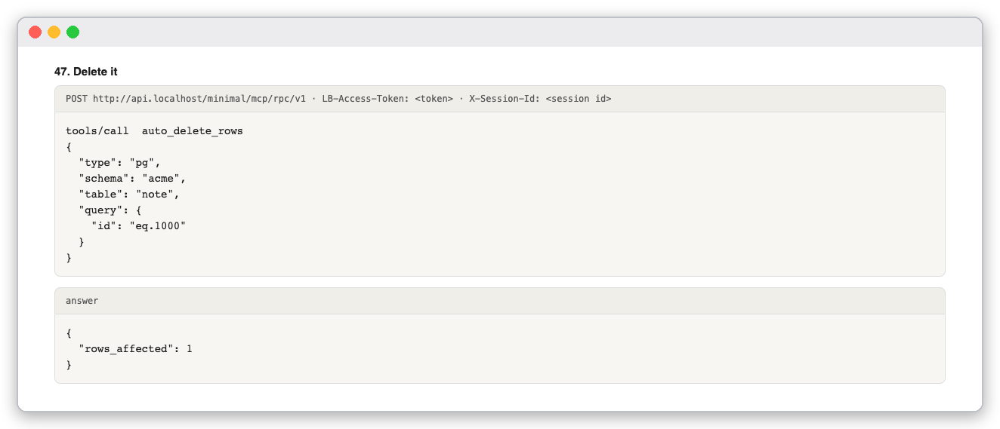

*One row deleted.*


*The **Note** page is back to its original rows.*

A delete without a filter is refused, so a whole table cannot be emptied by accident:

```text
the API answered 417 Expectation Failed: {"code":417,"status":"Expectation Failed","message":"unable to perform delete","details":"a valid SQL statement could not be formed reason: blanket delete detected, rejecting request"}
```

### Put the table back

Restore every lock flag to its first value, assign the original template back and delete yours. The first `get_table_lock_status` is your reference: afterwards its `lock_mask` and `permission_template_id` must match.

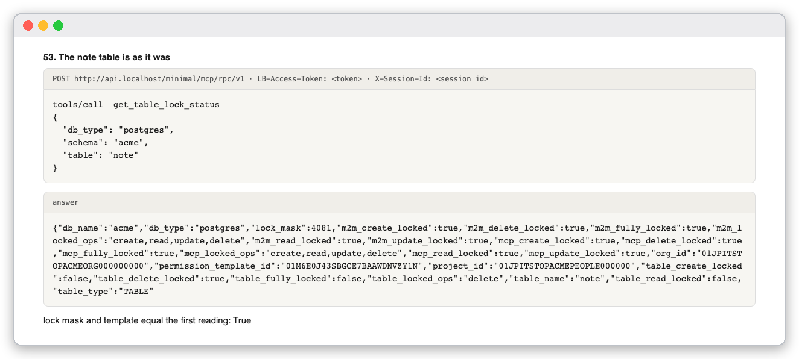

*After the restore the lock mask and template equal the first reading.*

## 5. Build an app

An app in Minimal is a catalogue entry. Its `app_info` is free-form, base64-encoded, and is handed back as HTML. An assistant can therefore read live data through a Custom API, write a page and store it.

1. Deploy a read endpoint for the data (`crm/stage-summary`: deals and value per stage) and call it.
2. Build a page from the answer and create the app. `is_public` lets `render_app` serve it to any caller who can read the project.

```json
{"name":"create_apps","arguments":{"apps":[{"app_id":"01JGUIDEAPP0000000000PIPE1","name":"Pipeline by stage","kind":"dashboard","description":"Deals and value per stage, built over MCP","creator_type":"human","is_public":true,"shared":true,"app_info":"<the page, base64-encoded>"}]}}
```

```json
{"rows_affected": 1}
```

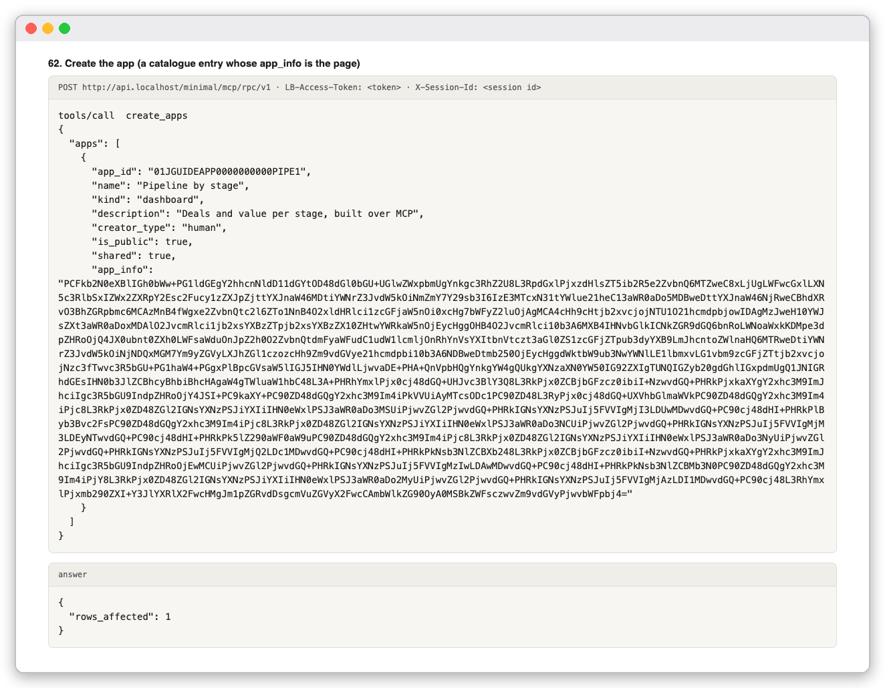

*The app registered. The answer is a count; send your own `app_id` if you need it back.*

3. Render it and save the answer as an HTML file:

```json
{"name":"render_app","arguments":{"app_id":"01JGUIDEAPP0000000000PIPE1"}}
```

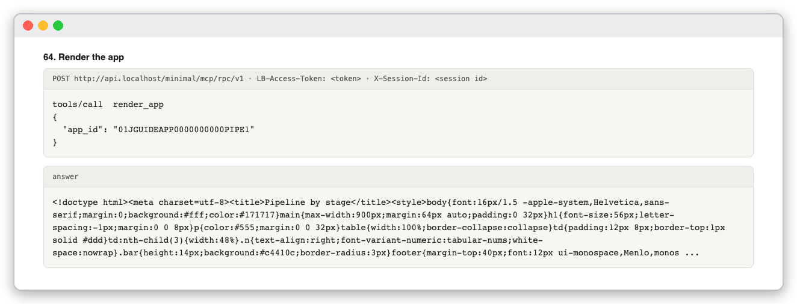

*The stored page, returned as text.*

4. Open the file in a browser:


*The page the assistant built from live data: deals and value per stage.*

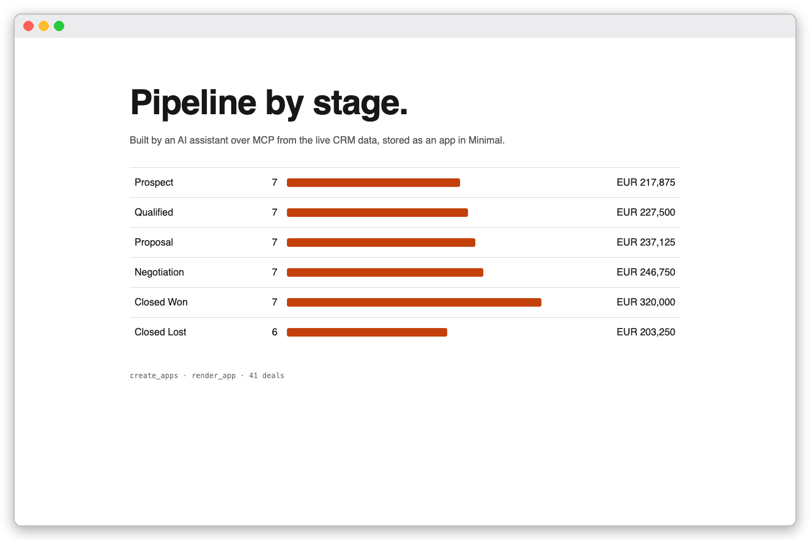

*The same steps on the Hosted install.*

## 6. Tokens, sessions and the audit trail

`create_access_token` mints a token for another client. Its roles must be a subset of yours, and `key_type` is four characters in create, read, update, delete order: a letter where the operation is allowed and `-` where it is not.

```json
{"name":"create_access_token","arguments":{"name":"guide-reader","roles":"admin","key_type":"-r--","token_type":"mcp","expires_in_days":1}}
```

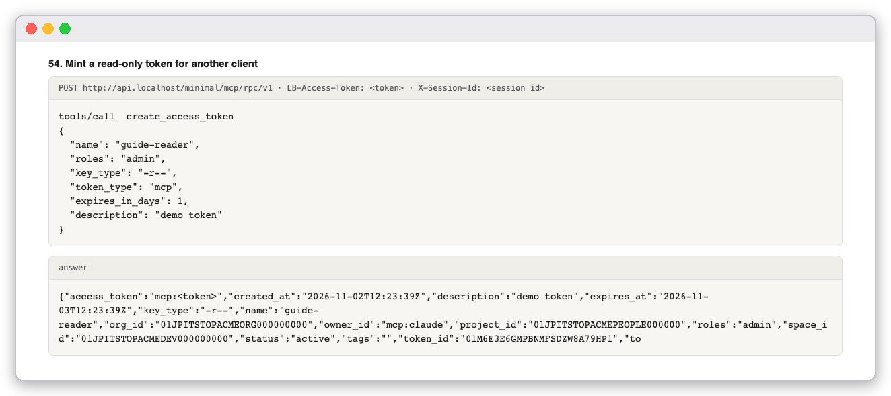

*The answer carries the new token once; it is masked in the screenshot. `list_access_tokens` and `delete_access_token` list and revoke.*

Every call you make is recorded to your session, and `read_my_audit_trail` shows the trail, as in section 2. Deleting what you deployed is part of the loop: `delete_definition`, `delete_app` and `delete_lua_module` remove their objects.

## Check yourself

- `tools/list` answers with 115 tools.
- A `create_definition` on a path that exists answers `409 Conflict`; a document without `feature_id` answers `400`.
- After the `crm/new-deal` call the app shows 41 deals; after you delete the row it is 40 again.
- `auto_read_rows` on a locked table is refused with `403`; after you unlock it and assign a template that names your role, it answers with rows.
- After section 4's restore, `get_table_lock_status` returns the same `lock_mask` and template as at the start.
- `render_app` returns HTML for an app whose `is_public` is true.

## Limits

- Deployed endpoints and apps live in the install's definition store. They are not part of the data tables, and `docker compose down -v` erases them with the rest.
- A token's secret is shown once. Revoke it with `delete_access_token`, or with `docker compose run --rm -T mcp-token --revoke <token id>`.
- Switching MCP off removes the listener: with `mcp: false` in `pitstop.yaml`, or `PITSTOP_MCP=false`, nothing answers and no token works.
